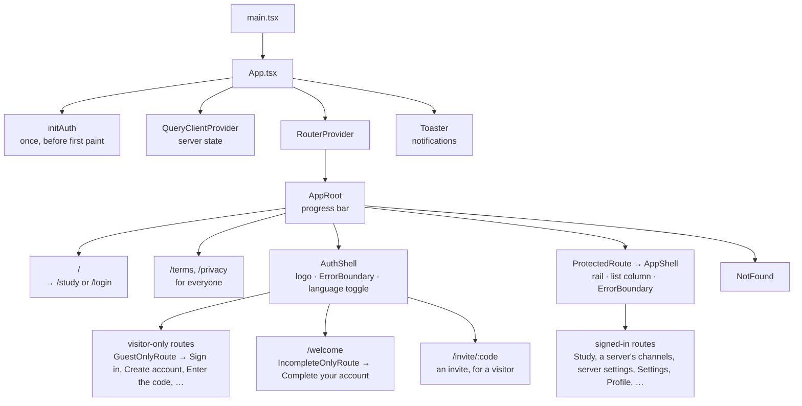
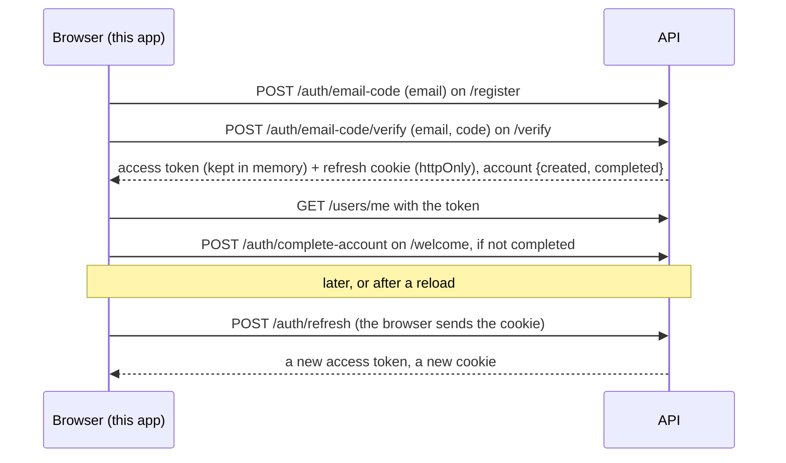
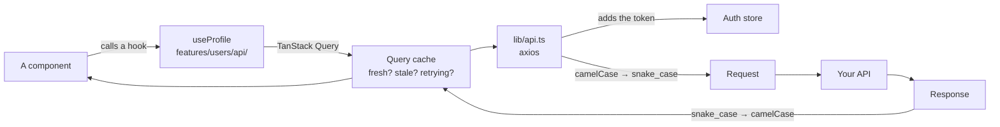
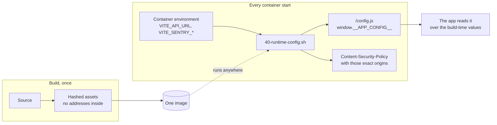

# A tour of the starter

Read this once and you will know what is in this repository, how the pieces
fit, and where to look for anything. It links out rather than repeating — each
section ends with the page that goes deep.

If you are impatient: [docs/setup/prepare-for-development.md](./docs/setup/prepare-for-development.md)
has it running, with the API, step by step, and you can come back.

- [What this is](#what-this-is)
- [Is it the right starting point for you?](#is-it-the-right-starting-point-for-you)
- [The shape of the app](#the-shape-of-the-app)
- [How someone signs in](#how-someone-signs-in)
- [How data gets on the screen](#how-data-gets-on-the-screen)
- [How the code is arranged](#how-the-code-is-arranged)
- [What is already handled for you](#what-is-already-handled-for-you)
- [One image, every environment](#one-image-every-environment)
- [Where things live](#where-things-live)
- [Doing the usual things](#doing-the-usual-things)
- [The decisions, and why](#the-decisions-and-why)
- [What this is not](#what-this-is-not)
- [A reading order](#a-reading-order)

## What this is

A React front end that is already wired to a real backend — which also does
the sign-in, with no separate identity server — and a real deployment.

`npm create vite` gives you a build tool and a blank page. The gap between
that and something you would put in front of users — sign-in that refreshes
its own tokens, an API client that speaks your backend's conventions, forms
that validate, errors that say something useful in two languages, a container
that serves it with the right cache headers — is most of the work, and it is
already done.

| | |
| --- | --- |
| **Sign-in** | Creating an account with an emailed code, "complete your account", sign-in, Google, password reset, deleting the account (14 days to restore it) — the rules in the API, the pages here |
| **Server data** | TanStack Query, with the retry and invalidation rules already thought through |
| **A real API client** | Case conversion both ways, idempotency keys, an error catalogue |
| **Types from the backend** | Generated from its OpenAPI document, so a changed response is a compile error |
| **The interface** | Tailwind and shadcn/ui, dark mode, English and Vietnamese, accessible forms |
| **Production** | One image for every environment, a CSP, CI, deploys with automatic rollback |

The paired [NestJS starter](https://github.com/StoriuSs/Nest-Hexagonal-No-Keycloak)
is the other half, and the auth pages need its auth routes. Anything else here
works against any backend that speaks the same envelope — point `VITE_API_URL`
at it.

Three things this app needs from the API, set **on the API**, not here:

| API setting | Why |
| --- | --- |
| `CORS_ORIGINS` names this app (`http://localhost:3001` in development, the API's default; `https://app.example.com` in production), with `CORS_CREDENTIALS=true` | Otherwise the browser refuses the API's answers, or never sends the refresh cookie |
| `FRONTEND_URL` is this app's address | The links in the API's emails and the return from Google point there |
| Email works | Creating an account (and signing in with a code) and password reset send a 6-digit code. In development the API's stack catches every email in **Mailpit**, at http://localhost:8025 |

Google sign-in has **no setting in this app**: it is turned on in the API, and
this app asks it whether it is on (`GET /auth/options`).

## Is it the right starting point for you?

**Yes, if** you are building a signed-in web application — a dashboard, an
admin tool, a SaaS product — against your own API, and you want the
authentication and data-fetching decisions already made.

**Probably not, if:**

- **You need server-side rendering or SEO.** This is a single-page app served
  as static files. A marketing site or anything Google must index wants
  Next.js or Remix.
- **You have no backend.** Half of what is here is about talking to one.
- **You need single sign-on across several apps, SAML or LDAP.** Sign-in here
  is done by the paired API itself: email and password, and Google, for this
  one app. Sign-in shared by several apps, or a company
  directory, wants an identity server (Keycloak, Auth0, Entra ID) in front of
  them, which this starter does not have.
- **It is a static page.** This is a lot of machinery for something with no
  users to sign in.

## The shape of the app



Two details in that picture are deliberate and easy to get wrong:

- **Auth initialises once, before anything renders.** The app shows a
  spinner until it knows whether you are signed in, so no page ever flashes
  the signed-out version at somebody who is signed in. It asks the API only
  when this browser has signed in before.
- **Errors are caught at two levels.** Each layout (`AuthShell`, `AppShell`)
  wraps the page in an error boundary, so a crashing page shows a message
  *while the navigation still works*. A crash in the layout itself is caught by the router's own error
  element. An earlier version wrapped the whole layout, so any render error
  removed every way of getting out.

## How someone signs in

The paired API does the sign-in itself; there is no identity server. **Every
rule is the API's** — password rules, codes, limits, how long a session lasts.
This app shows the pages, keeps the access token, and does what the API's
answers say.

On this app's own pages: `/register` asks only for an email, and the 6-digit
code from the email, typed on `/verify`, signs in, to a new account or to the
address's own. A new account then goes through `/welcome`, "complete your
account" (display name, username, password, time zone, the terms), before any
other page opens. Later visits use `/login`: an emailed one-time code by
default, or the password; the page opens on the way that last worked in this
browser. The API
answers a sign-in with a short-lived **access token** (15
minutes by default; the API's `JWT_ACCESS_TTL_SECONDS`), which this app keeps
**in memory only**, and a **refresh token** in an httpOnly cookie — a cookie
no script can read, so an injected script cannot steal it. Before the access
token runs out, or when a reload has wiped it, the app trades the cookie for
a new one (`POST /auth/refresh`).



- **Google.** "Continue with Google" appears when the API offers it (its
  `GET /auth/options` lists `google`). It is a page navigation, not a request:
  the browser goes to the API, the API to Google and back, and the API then
  sends the browser to this app's `/auth/callback` — with `?error=` when it
  did not work.
- **A reload asks the API only when it has reason to.** A small
  `auth:session` flag in `localStorage` (no secret in it) says this browser
  signed in before; without it, a visitor's page load sends no refresh at all.
- **`ProtectedRoute`** sends a visitor to sign in with the page they asked for,
  so they come back to it afterwards; `?next=` can only point at this site.
  It sends a signed-in account that has not done "complete your account" to
  `/welcome?next=<the page>`, and one waiting to be deleted to sign in, where
  `GuestOnlyRoute` keeps the page and opens the restore dialog over it.
- **An expired token is refreshed, not a sign-out.** A request refused with
  `AUTH_TOKEN_EXPIRED` or `AUTH_TOKEN_INVALID` is refreshed and retried once,
  without the user noticing. So is `AUTH_TOKEN_REVOKED`: another tab may have
  reset the password with a code, leaving a newer session in the shared
  cookie (D-74); if the refresh is refused, the sign-out gives its reason.
- **Not every 403 ends a session.** A `403` does *only* when the API says
  `AUTH_ACCOUNT_DISABLED`. A `403 ACCOUNT_INCOMPLETE` keeps the session and
  opens "complete your account"; a `403 ACCOUNT_PENDING_DELETION` keeps it
  too and opens the restore dialog. Every other 403 means "you may not do this",
  which is for the page to handle — signing people out for an ordinary
  permission error was a real bug.
- **A sign-out says why, and lands where it makes sense.** The API's 401 names
  the reason (`data.reason`: the password changed, "Sign out the other devices" chosen
  on another device, a security problem…). The app reloads. A session that
  ended by itself or elsewhere goes to `/login?next=<the page you were on>`,
  where a banner says why (and a password changed elsewhere opens on the
  password); signing out yourself goes home. Deleting the account waits 14
  days: every device lands on `/login` under a banner with the day it goes,
  and signing in before then offers to restore it (D-141).
- **Tabs stay in step.** Signing out in one tab signs the others out at once;
  signing in in one picks the session up in the others.

→ [docs/auth/README.md](./docs/auth/README.md) — the pages and flows, the
session, forms and errors, the settings page, and the code.

## How data gets on the screen



The rule that keeps this simple: **anything the backend owns belongs to
TanStack Query, and nowhere else.** Do not copy it into a store — the copy is
what goes stale. Client state (the theme, whether a dialog is open, the
session) lives in a hook or a small Zustand store.

`lib/api.ts` does three things so no component has to: attaches the token
(refreshing it first when it is about to expire), converts the casing both
ways, and handles the API ending a session (refresh and retry once, or sign
out). Two things live elsewhere on purpose: the `Idempotency-Key` comes from
`useIdempotentMutation`, one per thing the user meant to do (an interceptor
would mint a new one per attempt), and turning an error's machine-readable
`meta.type` into a translated message is `lib/api-error.ts`.

→ [data-fetching.md](./docs/data-fetching.md) ·
[state-management.md](./docs/state-management.md)

## How the code is arranged

**Code that belongs to one feature lives with that feature. Everything else is
shared.**

```
src/
├── app/            # The shell: providers, router, layout
├── components/     # Shared UI — ui/ (shadcn), form/, boundaries
├── config/         # Settings, validated with zod
├── features/       # ← most new code goes here
│   ├── auth/       # Session store, the auth pages, Google, route and role guards
│   ├── servers/    # Servers, channels, invites, server settings: api/ · components/ · hooks/ · lib/ · pages/ · routes.tsx
│   ├── realtime/   # The tab's socket and its connection Banner: api/ · hooks/ · lib/ · realtime.store.ts
│   ├── messaging/  # A text channel's chat (mentions included) and its pins, lazy: api/ · components/ · hooks/ · lib/ · types.ts
│   └── users/      # api/ · components/ · hooks/ · lib/ · pages/ · routes.tsx · types.ts
├── hooks/          # Shared hooks
├── i18n/           # Translations
├── lib/            # The API client and friends
└── pages/          # Pages belonging to no feature
```

The alternative — a `components/` folder, a `queries/` folder and a `stores/`
folder each holding fragments of every feature — reads well in a tree diagram
and badly in practice: working on "profile" means jumping between four
folders, and deleting a feature means hunting its pieces out of all of them.

Each feature contributes its own `routes.tsx`, so adding one does not mean
editing a central list of every route in the application.

→ [project-structure.md](./docs/project-structure.md)

## What is already handled for you

| | What it does for you | Where |
| --- | --- | --- |
| **Authentication** | Seven auth pages, Google, route and role guards, and the right behaviour when the API ends a session | [docs/auth/README.md](./docs/auth/README.md) |
| **Server data** | Query keys per feature, sensible retries — 4xx is not retried — and cache updates after mutations | [data-fetching.md](./docs/data-fetching.md) |
| **API types** | Generated from the backend's OpenAPI document; a changed response shape is a build error, not a runtime surprise | [api-types.md](./docs/api-types.md) |
| **Errors the user reads** | The API answers with a `type`, not a sentence, and the catalogue turns it into a translated message | [i18n.md](./docs/i18n.md) |
| **Forms** | React Hook Form and zod, with one `FormField` deciding how a label, control and error are laid out | [shadcn-forms.md](./docs/shadcn-forms.md) |
| **Components** | shadcn/ui — copied into the repository, so you can edit them | [components.md](./docs/components.md) |
| **Theming** | Light, dark and system, kept by the account and followed by every tab and browser, with no flash of the wrong one on load | [theme-system.md](./docs/theme-system.md) |
| **Languages** | English and Vietnamese, with typed keys (a key that does not exist is a type error) and a test that fails when Vietnamese misses one; a page's words can load with its chunk | [i18n.md](./docs/i18n.md) |
| **Loading fast** | Routes split into chunks, a progress bar, skeletons instead of layout jumps | [code-splitting.md](./docs/code-splitting.md) |
| **Not crashing** | Error boundaries at two levels, and storage access that survives blocked site data | [project-structure.md](./docs/project-structure.md) |
| **Idempotency** | One key per user intent, so a double-tapped button does the work once | [data-fetching.md](./docs/data-fetching.md) |
| **Error tracking** | Sentry, off unless you set a DSN (and then its SDK is downloaded, not before), with tokens, codes and personal data scrubbed | [error-tracking.md](./docs/error-tracking.md) |

## One image, every environment

The single most useful thing to understand about deploying this.

Vite normally bakes `VITE_*` values into the JavaScript at build time — which
would mean one image per environment, and a rebuild every time an address
changes. **This starter does not do that.**



What that buys you:

- The image CI publishes from `main` is the **same image** that runs in
  staging and in production.
- Changing an API address is an environment change and a restart, not a
  rebuild.
- A missing setting **stops the container**, by name. A site that loads and
  cannot reach its API is a worse failure than one that does not start.
- `/config.js` is served `no-store`, because a cached copy would pin people to
  the old API long after a deploy.

Error tracking follows the same rule: the Sentry DSN and the release the
browser reports are read at container start too. Only the **sourcemap
upload** belongs to the build (`SENTRY_ORG`, `SENTRY_PROJECT`,
`SENTRY_AUTH_TOKEN`, and the release name the maps are filed under), because
it describes the files that build produced.

→ [environment.md](./docs/environment.md) · [docker.md](./docs/docker.md)

## Where things live

```
├── src/                # See "How the code is arranged"
├── public/             # Served as-is — the development config.js lives here
├── e2e/                # Playwright: real browsers, against the app
├── k6/                 # Load test for the built site
├── nginx/              # The start-up script (config.js, the CSP), the security headers,
│                       #   and the host's nginx template and bootstrap script
├── scripts/            # API types, the CSP generator, CI's image check and pull retries;
│                       #   constraints/: the checks behind check:fast, check:task, check:full and CI (CONSTRAINTS.md)
├── nginx.conf          # The container's nginx: cache headers, deep links, /config.js
├── deploy.sh           # Releases, rollback, history
└── docker-compose.{dev,prod}.yaml
```

| You want to change | Look in |
| --- | --- |
| A page or a feature | `src/features/<name>/`, or `src/pages/` if it has no data |
| What is behind sign-in | That feature's `routes.tsx`, or `ProtectedRoute` |
| A setting | `.env.example`, `src/config/env.schema.ts`, the prod compose file and `nginx/40-runtime-config.sh` — a test fails if you miss one ([environment.md](./docs/environment.md#adding-a-variable)) |
| How requests are made | `src/lib/api.ts` |
| Wording, in any language | `src/i18n/locales/` |
| Colours and spacing | `src/index.css` and `tailwind.config.js` |
| Cache headers, deep links | `nginx.conf` |
| The Content-Security-Policy | `scripts/csp.mjs` (generated at build), filled in by `nginx/40-runtime-config.sh` at start |

## Doing the usual things

| I want to… | Start here |
| --- | --- |
| Add a page | [project-structure.md](./docs/project-structure.md#adding-a-page) |
| Add a feature | [project-structure.md](./docs/project-structure.md#adding-a-feature) |
| Fetch something from the API | [data-fetching.md](./docs/data-fetching.md) |
| Regenerate the API types after a backend change | `pnpm api:types` — [api-types.md](./docs/api-types.md) |
| Build a form | [shadcn-forms.md](./docs/shadcn-forms.md) |
| Add a UI component | `pnpm dlx shadcn@latest add <name>` — [components.md](./docs/components.md) |
| Add or change wording | [i18n.md](./docs/i18n.md) |
| Put a page behind sign-in, or behind a role | [docs/auth/in-the-code.md](./docs/auth/in-the-code.md) |
| Set up a fresh machine, or a first production deploy | [docs/setup/](./docs/setup/README.md) |
| Add a setting | [environment.md](./docs/environment.md) |
| Write a test | [testing.md](./docs/testing.md), and [e2e-testing.md](./docs/e2e-testing.md) for the browser |
| Deploy it | [deployment-guide.md](./docs/deployment-guide.md) |

## The decisions, and why

**Settings at runtime, not build time.** Explained above; it is the difference
between one image and one image per environment.

**TanStack Query owns server state; Zustand owns almost nothing.** A few small
stores: the auth session (who is signed in; the token itself sits in a module
of its own), the theme, a removed avatar waiting out its Undo, and which of
the servers dialogs the AppShell shows. Two sources of truth for the
same data is the bug you spend a week on.

**Errors are matched on `type`, not on message text.** The backend sends
`USERNAME_CONFLICT`; the catalogue turns it into a sentence in the user's
language. Matching on the sentence breaks the moment anyone rewords it.

**Types generated from the backend's OpenAPI document.** Hand-written
interfaces drift silently. Generated ones turn a backend change into a red
squiggle.

**`snake_case` on the wire, `camelCase` in the code.** Converted once, in the
API client, through a helper that survives `FormData`, `Blob` and arrays — the
libraries throw on all three.

**shadcn/ui, copied rather than installed.** The components are in your
repository and you can edit them. The cost is that updates are yours to apply.

**Idempotency keys per intent, not per request.** A key minted per HTTP
attempt defeats the entire point: the retry looks like a new request. One key
per thing the user meant to do.

**Only errors go to Sentry, not traces.** Tracing is a bigger bundle for
something most applications read once. A failed API request is not reported at
all — the backend already reports its own.

## What this is not

Deliberately absent, with a page explaining what each would take:

- Storybook, a PWA, feature flags, analytics, real-time updates, multilingual
  *content* → [extensions.md](./docs/extensions.md)
- Server-side rendering — a different framework, not a feature to add.
- A component library — `components/ui/` is shadcn/ui as a starting point, not
  a design system.

## A reading order

**If you just want it running:**
[docs/setup/prepare-for-development.md](./docs/setup/prepare-for-development.md)
(the API first, then this app, then a first account through Mailpit).

**Once it runs and you are starting a real project:**
[making-it-yours.md](./docs/making-it-yours.md) — the renaming pass.

**If you are new to React**, or coming from Vue:

1. [react-concepts.md](./docs/react-concepts.md) — the mental model
2. [project-structure.md](./docs/project-structure.md) — where code goes
3. [data-fetching.md](./docs/data-fetching.md) — the part that surprises people
4. [components.md](./docs/components.md) and [shadcn-forms.md](./docs/shadcn-forms.md)
5. [docs/auth/README.md](./docs/auth/README.md)

**If you are experienced and just want the map:** this page, then read
`src/lib/api.ts` and `src/features/users/` end to end. Between them they show
every pattern the repository uses.

**Before you deploy:**
[docs/setup/prepare-for-production.md](./docs/setup/prepare-for-production.md),
then [environment.md](./docs/environment.md) and
[deployment-guide.md](./docs/deployment-guide.md).
