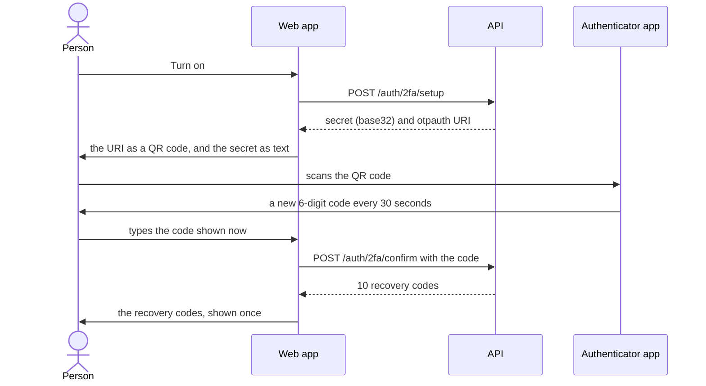

# Account settings

This page explains what a signed-in person can change about how they sign in:
the password, two-step sign-in, signing out on every device, and deleting the
account. It says what each screen shows, what it asks the API, and why. Read
it before changing the settings page, or to answer "how do I...?" for someone
using the app.

The settings page is `/settings` (the account menu → **Settings**;
[Settings.tsx](../../src/features/auth/pages/Settings.tsx)). Deleting the
account is on the profile page, `/profile`. Both are for signed-in people
only.

- [The settings page at a glance](#the-settings-page-at-a-glance)
- [Change the password](#change-the-password)
- [Set a first password](#set-a-first-password)
- [Two-step sign-in](#two-step-sign-in)
- [Sign out everywhere](#sign-out-everywhere)
- [Delete the account](#delete-the-account)
- [Every API call on these screens](#every-api-call-on-these-screens)

## The settings page at a glance

| Section | Shows when | What it does |
|---|---|---|
| **Change password** | the account has a password | Changes it; signs out every other device |
| **Set a password** | the account has none (it was made with Google) | Adds one, with an emailed code |
| **Two-step verification** | always | Turns it on (QR code, a code, recovery codes), makes new recovery codes, turns it off |
| **Sign out everywhere** | always | Ends every session of the account, this one included |

The first thing the page does is ask the API how the account signs in:
`GET /auth/sign-in-methods`, which answers `{ password: true|false,
providers: ["google"] }`. Until the answer is in, the password section shows
"Loading..." and neither form: "Change password" would be wrong for an
account that has no password. If the question fails, it says "Your sign-in
details couldn't be loaded." with **Try again**.

## Change the password

1. The form: current password, new password (with the
   [rules checklist](./forms-and-errors.md#the-password-rules)), new password
   again. A hidden field carries the account's email, so a password manager
   files the new password under the right account.
2. `POST /auth/change-password` with `current_password` and `new_password`.
3. The API checks the current password and the rules (against the email and
   the username), saves the new password, **ends every other session** of the
   account, and emails the owner. This session stays.
4. The page empties the form and says "Password changed. Other devices have
   been signed out."

Other tabs in this browser share this session, so they stay signed in. Another
device's next request is refused, and it shows "Your password was changed, so
you were signed out here. Sign in with the new password."
([session.md](./session.md#why-a-session-ended-every-reason)).

| Refusal | The page |
|---|---|
| `400 AUTH_CURRENT_PASSWORD_INVALID` | "Your current password is not right", under that field |
| `422 AUTH_PASSWORD_REJECTED` | the broken rules on the checklist |
| `429`, reason `wrong_password` | five wrong current passwords in 15 minutes: "Too many wrong passwords. Try again in ..." |

## Set a first password

An account made with "Continue with Google" has no password. The section
reads "You sign in with Google. Set a password to sign in with your email
address too. We email you a code first, to check it is you."
([SetPasswordSettings.tsx](../../src/features/auth/components/SetPasswordSettings.tsx)).

**Why a code, when the person is already signed in?** A signed-in browser is
not proof enough: someone at an unlocked computer could otherwise add a
password and keep a way into the account. The code proves the person also
controls the mailbox.

1. **Email me a code** → `POST /auth/password/code`. The API emails a 6-digit
   code that works for 10 minutes.
2. The form opens: "We sent a 6-digit code to you@example.com...". The code,
   the new password with the checklist, the new password again.
3. **Set password** → `POST /auth/password` with `code` and `new_password`.
4. The page says "Password set. You can now sign in with your email address
   and this password too.", asks the API again how the account signs in, and
   now shows **Change password**. Google keeps working, and no session ends.
   The API emails the owner that a password was added.

Details that save a second email:

- **I already have a code** opens the form without sending another (a new
  code would replace the one in the inbox).
- A reload within those 10 minutes reopens the form by itself: the tab
  remembers sending the code.
- **Send a new code** waits a minute after the last one, as the API does.

| Refusal | The page |
|---|---|
| `400 AUTH_CODE_INVALID` or `AUTH_CODE_EXPIRED` | under the code field |
| `422 AUTH_PASSWORD_REJECTED` | the broken rules on the checklist |
| `409 AUTH_PASSWORD_ALREADY_SET` | a password was set meanwhile (another tab): the message, and the section switches to "Change password" |
| `429`, reason `emails` | the wait; the send button counts down |

"Forgot your password?" on the sign-in page also works for these accounts: it
sets a first password the same way, signed out.

## Two-step sign-in

Two-step sign-in (the screens say "two-step verification") asks for a second
thing at sign-in, after the password: a 6-digit code from an **authenticator
app** on the person's phone. The section is
[TwoStepSettings.tsx](../../src/features/auth/components/TwoStepSettings.tsx).

### What it is, in plain words

A password is something you *know*; it can leak, be guessed, or be reused from
another site. The phone is something you *have*. With two-step sign-in on, a
stolen password alone no longer opens the account.

How the phone's codes work:

1. When the person turns it on, the API makes a **secret**: 20 random bytes,
   written as 32 characters of *base32* (the letters A to Z and the digits 2
   to 7, which are hard to mistype) so a person could type it.
2. The phone's app and the API both keep that secret. It is shared once, when
   the person scans the QR code, and never again.
3. Every 30 seconds, the app and the API each compute a 6-digit code from the
   secret and the current time. Nothing travels between the phone and the
   API: they arrive at the same code because they share the secret and the
   clock. This kind of code is called *TOTP* (time-based one-time password).
4. At sign-in the API accepts the code for the current 30 seconds, or the one
   just before or after (a phone's clock is rarely exact), and each code only
   once, so a code seen over someone's shoulder cannot be used again.

How the code is computed from the secret, and how the API stores the secret,
is in the API starter's `docs/auth/two-step-sign-in.md`.

### Turning it on



1. **Turn on** → `POST /auth/2fa/setup`. The API makes a new secret and
   answers with two things:
   - `secret`: the base32 secret, like `JBSWY3DPEHPK3PXP...` (32 characters);
   - `otpauth_uri`: the same secret packed into the address format
     authenticator apps read, with the API's `APP_NAME` as the issuer and the
     person's email as the label:
     ```
     otpauth://totp/YourAppName:you%40example.com?issuer=YourAppName&secret=JBSWY3DPEHPK3PXP...&algorithm=SHA1&digits=6&period=30
     ```
   Nothing changes at sign-in yet: the secret is not asked for until it is
   confirmed.
2. **The page draws the URI as a QR code** with the `qrcode.react` package
   (`QRCodeSVG`), right in the browser. The secret never goes to an outside
   QR service. The code is dark on white whatever the app's theme: some apps
   cannot read a light-on-dark code. Under it, for a phone that cannot scan,
   the secret is shown in groups of four (`JBSW Y3DP EHPK 3PXP ...`), easier
   to type, with **Copy key**.
3. **The person scans it** with any authenticator app: Google Authenticator,
   Microsoft Authenticator, 1Password, Bitwarden and others. The app adds an
   entry named after the API's `APP_NAME` and the email, and from then on
   shows a new 6-digit code every 30 seconds.
4. **The person types the code the app shows now** → `POST /auth/2fa/confirm`
   with `code` (a code from the app; a recovery code is not accepted here). The
   right code turns two-step sign-in on.
5. **The API answers with 10 recovery codes**, shown once
   ([below](#the-recovery-codes)). It also emails the owner that two-step
   sign-in was turned on.

**Cancel** only hides the setup. Starting again makes a new secret, so an
entry the person added to their app from an earlier, unfinished attempt stops
working; the screen says to delete it ("Started this before and stopped
halfway? Delete that earlier entry from your app: its codes won't work.").

| Refusal at step 4 | The page |
|---|---|
| `400 AUTH_TWO_FACTOR_CODE_INVALID` | "That code isn't right. 4 tries left.", under the field. Usually a phone clock that is off, or an entry from an earlier attempt |
| `429`, reason `wrong_codes` | five wrong codes in 15 minutes for this account (the same count as at sign-in): the wait |
| `409 AUTH_TWO_FACTOR_ALREADY_ON` | turned on in another tab: the message, and the section shows it as on |

### The recovery codes

A **recovery code** replaces the phone's code once, for someone who lost or
reset their phone. There are 10, each shaped `XXXXX-XXXXX` (letters and
digits, without the easily confused 0, O, 1, I and L). The API keeps only a
fingerprint of each, so nobody, not even the API, can show them again.

The screen that shows them:

- says "Save these recovery codes somewhere safe. Each one signs you in once if
  you lose your phone. They won't be shown again.";
- lists the 10 codes;
- **Copy codes** puts them on the clipboard, one per line (over plain `http`
  the browser may refuse; the page then says to select and copy the text);
- **Download** saves them as a text file, `<this site's hostname>-recovery-codes.txt`;
- **I've saved them** closes the list.

**While the codes are on screen, leaving is held.** A link inside the app is
stopped with "Leave without saving your recovery codes? They won't be shown
again.", and **Stay and save them** or **Leave anyway**. Closing or reloading
the tab gets the browser's own "Leave site?" question.

### When it is on

The section asks `GET /auth/2fa` (`{ enabled, recovery_codes_left }`) and
shows "On. 7 recovery codes left." With 3 or fewer left it suggests making a
new set; with none left it warns that losing the phone would lock the person
out.

**New recovery codes:** a code from the app → `POST /auth/2fa/recovery-codes`.
The API makes 10 new codes, and the old ones stop working. They are shown
once, exactly as above. The API emails the owner.

**Turning it off:** a code from the app *or* a recovery code →
`POST /auth/2fa/disable`. A code is asked for so that a browser left signed in
is not enough to remove the protection. The API removes the secret and the
recovery codes, and emails the owner.

None of these end a session. Wrong codes count towards the same limit as at
sign-in: five per 15 minutes per account.

### A lost phone

1. At sign-in, after the password, choose **Use a recovery code instead** and
   type one.
2. In settings, turn two-step sign-in off (with another recovery code), then
   on again with the new phone.

Without the phone or any recovery code, only the API's operator can help: the
API starter's `pnpm auth:two-factor:off <email>` turns it off for that account
(its `docs/auth/operations.md`).

## Sign out everywhere

The last section on the settings page.

1. **Sign out everywhere** asks once more: "Sign out on every device, this one
   included?"
2. **Yes, sign out everywhere** → `POST /auth/logout-all`. The API ends every
   session of the account and clears this browser's cookie.
3. Only once the API has answered, the page signs out here too: the app
   reloads at the home page with "You're signed out on every device."

If the request fails, the other devices are still signed in, so this one stays
signed in too and says so: "You're still signed in: signing out everywhere
didn't work." The page does not pretend to be done when it is not.

Every other device finds out on its next request, and shows "You were signed
out: "Sign out everywhere" was chosen on one of your devices." Other tabs in
this browser sign out at once ([session.md](./session.md#several-tabs)).

## Delete the account

On `/profile`, under **Danger zone**: **Delete account** opens a dialog
([DeleteAccountDialog.tsx](../../src/features/auth/components/DeleteAccountDialog.tsx)):
"This can't be undone. You'll be signed out on every device, and your personal
details will be erased."

**Why proof is needed.** A signed-in session alone (an unlocked laptop, a
borrowed phone) must not be enough to destroy an account. The API refuses
without proof, so the dialog asks for it.

When it opens, the dialog asks the API what the account has
(`GET /auth/sign-in-methods` and `GET /auth/2fa`), and asks for exactly the
proof it needs:

| The account | The dialog asks for |
|---|---|
| has a password | the password |
| has no password (made with Google) | an emailed code: **Email me a code** → `POST /auth/account/delete-code`, then the 6 digits |
| has two-step sign-in on | also a code from the app, or a recovery code |

**Delete my account** is enabled once those are filled in. It sends
`POST /auth/account/delete` with `password` or `code`, and `two_factor_code`
when needed. The API checks the proof, deletes the account, ends every
session, clears the cookie, and emails a confirmation. The app then signs out
and reloads at the home page with "Your account was deleted. We've emailed you
a confirmation."

| Refusal | The dialog |
|---|---|
| `400 AUTH_CURRENT_PASSWORD_INVALID` | "That password isn't right.", under the password |
| `400 AUTH_CODE_INVALID` or `AUTH_CODE_EXPIRED` | under the emailed code |
| `400 AUTH_TWO_FACTOR_CODE_INVALID` | under the two-step code, with tries left |
| `400 AUTH_CONFIRMATION_REQUIRED` | the account changed meanwhile (two-step turned on in another tab): it asks the API again what to show |
| `409 AUTH_USE_PASSWORD` | the account has a password after all (set in another tab): it asks for the password instead |
| `429` | the wait; "Email me a code" counts down |

Closing the dialog clears it. What the API removes, and when the personal
details are finally erased, is in the API starter's `docs/auth/accounts.md`.

## Every API call on these screens

| Screen | Method and route | Sends | Answer used |
|---|---|---|---|
| Settings, on open | `GET /auth/sign-in-methods` | — | `password`, `providers` |
| Change password | `POST /auth/change-password` | `current_password`, `new_password` | — |
| Set a password | `POST /auth/password/code` | — | — |
| Set a password | `POST /auth/password` | `code`, `new_password` | — |
| Two-step, status | `GET /auth/2fa` | — | `enabled`, `recovery_codes_left` |
| Two-step, turn on | `POST /auth/2fa/setup` | — | `secret`, `otpauth_uri` |
| Two-step, confirm | `POST /auth/2fa/confirm` | `code` (app) | `recovery_codes` (10) |
| Two-step, new codes | `POST /auth/2fa/recovery-codes` | `code` (app) | `recovery_codes` (10) |
| Two-step, turn off | `POST /auth/2fa/disable` | `code` (app or recovery) | — |
| Sign out everywhere | `POST /auth/logout-all` | — (with the cookie) | — |
| Delete, no-password account | `POST /auth/account/delete-code` | — | — |
| Delete | `POST /auth/account/delete` | `password` or `code`, `two_factor_code`? (with the cookie) | — |

The app writes these in camelCase (`currentPassword`, `twoFactorCode`); the
API client turns them into snake_case on the way out, and the answers back
into camelCase (`otpauthUri`, `recoveryCodes`).
