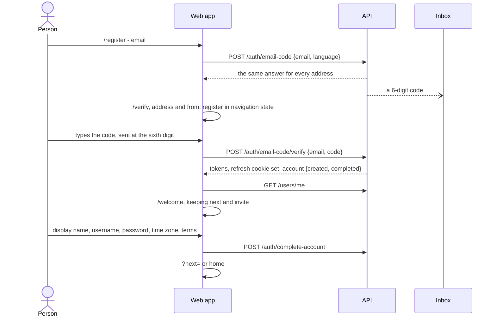
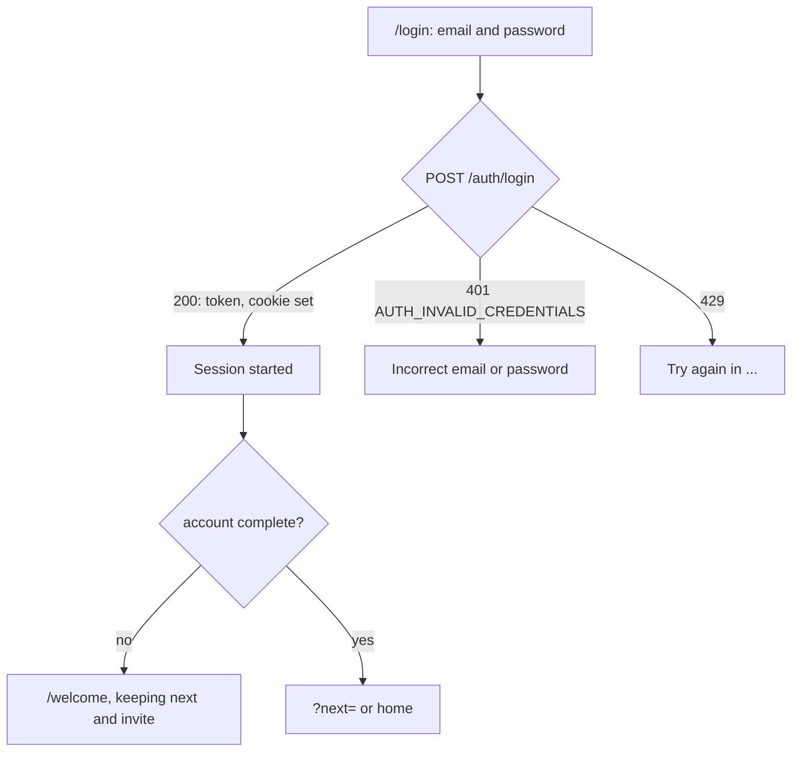
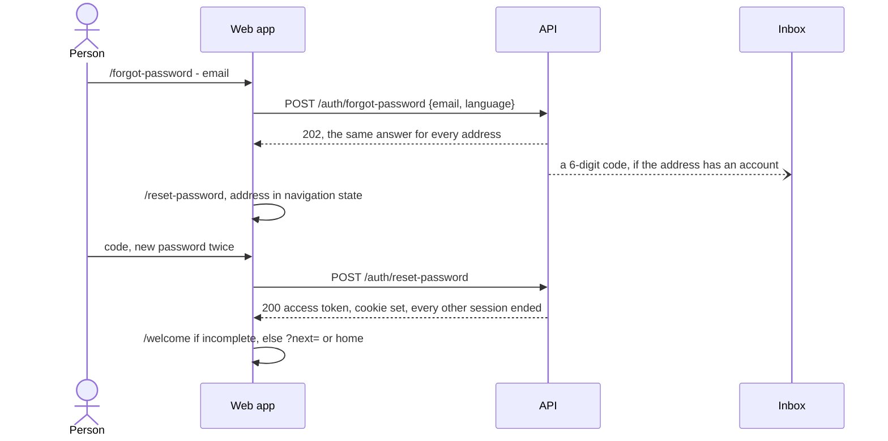
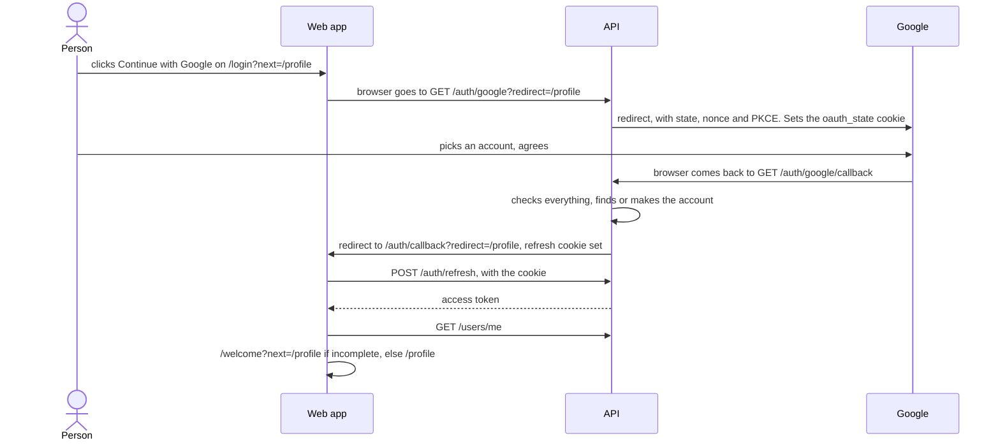

# The auth pages and flows

This page walks through every sign-in page of the web app: its address, who
may open it, what it shows, what it asks the API, and where it goes next. Read
it to understand what happens when someone clicks, or before changing a page.
For the session behind the pages, see [session.md](./session.md); for the
messages a form shows, [forms-and-errors.md](./forms-and-errors.md).

- [All the pages at a glance](#all-the-pages-at-a-glance)
- [Where the person goes afterwards: `?next=` and `?invite=`](#where-the-person-goes-afterwards-next-and-invite)
- [What one page hands the next](#what-one-page-hands-the-next)
- [Create an account](#create-an-account)
- [Enter the code](#enter-the-code)
- [Complete your account](#complete-your-account)
- [The gate: an incomplete account sees only `/welcome`](#the-gate-an-incomplete-account-sees-only-welcome)
- [Sign in](#sign-in)
- [Forgot and reset the password](#forgot-and-reset-the-password)
- [Continue with Google](#continue-with-google)
- [Already signed in: what visitor pages do](#already-signed-in-what-visitor-pages-do)
- [Pages for signed-in people](#pages-for-signed-in-people)
- [The terms and the privacy policy](#the-terms-and-the-privacy-policy)
- [Your menu](#your-menu)

## All the pages at a glance

The routes are in [routes.tsx](../../src/features/auth/routes.tsx), the paths
in [paths.ts](../../src/features/auth/lib/paths.ts) (`AUTH_PATHS`). Each page is
loaded only when first opened (`lazy`).

| Path | Who may open it | What it does | Asks the API | Goes next |
|---|---|---|---|---|
| `/register` | visitors | Only the email; "Continue with Google" | `POST /auth/email-code` | always `/verify` |
| `/verify` | visitors | The 6-digit code from the email. The right code signs in, to the address's account or to one made just now | `POST /auth/email-code/verify`, `POST /auth/email-code` (send again) | `/welcome` for an incomplete account, else `?next=` or home |
| `/welcome` | signed in, account not yet complete | "Complete your account": display name, username, password, time zone, the terms | `POST /auth/complete-account` | `?next=` or home |
| `/login` | visitors | Email and password; "Continue with Google" | `POST /auth/login` | `/welcome` for an incomplete account, else `?next=` or home |
| `/forgot-password` | visitors (a signed-in person sees a card) | Asks for a code to choose a new password | `POST /auth/forgot-password` | always the reset page |
| `/reset-password` | visitors (a signed-in person sees a card) | The code and a new password. Signs in, and signs out every other device | `POST /auth/reset-password` | as `/login` |
| `/auth/callback` | anyone | Where the API sends the browser back after Google | `POST /auth/refresh` | as `/login`; or says why it failed |
| `/settings` | signed in, complete | Password, sign out everywhere ([account-settings.md](./account-settings.md)) | several | stays |
| `/profile` | signed in, complete | The profile, and "Delete account" ([account-settings.md](./account-settings.md#delete-the-account)) | several | stays |
| `/terms`, `/privacy` | anyone | The Terms of Service and the Privacy Policy ([below](#the-terms-and-the-privacy-policy)) | nothing | stays |

"Visitors" means the page is wrapped in `GuestOnlyRoute`: a signed-in person
is sent on ([below](#already-signed-in-what-visitor-pages-do)). "Signed in,
complete" means `ProtectedRoute`: a visitor is sent to sign in and brought
back afterwards, an incomplete account to `/welcome`
([below](#the-gate-an-incomplete-account-sees-only-welcome)). `/welcome` has
its own guard, `IncompleteOnlyRoute`.

The pages before `/welcome` used to be `/sign-in`, `/sign-up` and
`/verify-email`; they were renamed to the product spec's addresses. The old
sign-up, which asked for a password and then confirmed the address, is gone
([Create an account](#create-an-account) is what replaced it).

## Where the person goes afterwards: `?next=` and `?invite=`

Someone who opens `/profile` while signed out should land on `/profile` once
signed in, even if they first create an account and complete it. The page
they were heading for travels in the address as `?next=`; an invite link
waiting for them travels as `?invite=`:

1. `ProtectedRoute` sends them to `/login?next=%2Fprofile` (`signInPath()`).
2. Every link between auth pages keeps `next` and `invite`, and nothing else
   (`withFlow(path, search)` in `paths.ts`): login → register → verify →
   welcome, login → forgot → reset.
3. "Continue with Google" hands `next` to the API, which hands it back on
   `/auth/callback`. The API's own name for it is `redirect`:
   `oauthStartUrl(provider, next)` in [oauth.ts](../../src/features/auth/lib/oauth.ts)
   sends `?redirect=`, and the callback page reads `?redirect=` back.
4. Once signed in, the page goes to `afterSignIn(account, search)`, with
   `replace`, so the browser's Back button does not return to a sign-in page.
   An account that has not done "complete your account" goes to `/welcome`,
   keeping `next` and `invite`; any other goes to `safeNext(next)`. Without a
   `?next=`, that is "home": the Study page, `/study`.

**`safeNext()` only allows a page on this site.** It returns the path
(with its query and `#` part) when the address resolves to this app's own
origin, and `/study` otherwise. It also returns `/study` for the sign-in pages
themselves (`isSignInFlowPage`): after signing in, `/login` is a dead end. Why:
without the check, a link to `/login?next=https://evil.example` would send
someone to a look-alike site straight after they signed in, where a "please
sign in again" page would collect their password. The API checks the address
it gets from Google's round trip in the same spirit.

## What one page hands the next

Pages pass the address typed so far, and what just happened, in the router's
**navigation state** (an invisible note attached to the history entry), never
in the address bar. [page-state.ts](../../src/features/auth/lib/page-state.ts)
holds the shapes (`authPageState(email, extra)`, `useAuthPageState()`):

| State | Set by | Read by | Meaning |
|---|---|---|---|
| `email` | register, login ("Forgot your password?"), forgot-password, verify's Back and "Sign in with password" | the next page | Fill the address in, or show it as text |
| `from: 'register' \| 'login'` | the page that sent the code | verify | Where Back returns; whether to say "you already have an account" |
| `notice: 'code-sent'` | forgot-password | reset | "Check your inbox" |
| `via: 'google'` | `/auth/callback` | welcome | The subtitle says the address was confirmed through Google |

Why not the address bar: an email address in the URL ends up in the browser's
history, the web server's access log and the page addresses error tracking
records. Navigation state lives in the tab only. A reload keeps it; a new tab
starts without it, which only means typing the address again. Pages check what
they read (`useAuthPageState`): a history entry can hold anything.

## Create an account

Creating an account takes three pages: the email, the emailed code, then
"complete your account". Signing in with a code is the same code and the same
`/verify` page (D-60).

**`/register`** ([Register.tsx](../../src/features/auth/pages/Register.tsx), S-AUTH-01, D-59):

1. The page asks only for the email; "Continue with Google" sits under it when
   the API offers Google. The form checks it is an address. Nothing else is
   asked here: the rest of the account comes after the code, on `/welcome`.
2. `POST /auth/email-code` with `email` and the language on screen (the
   email is written in it). The page records that a code was sent
   (`recordCodeSent('sign-in', email)`, for the
   ["send again" countdown](./forms-and-errors.md#send-another-code-timers))
   and moves to `/verify` with the address and `from: 'register'`.
3. **The same address again within the minute** goes straight to `/verify`
   without sending another email (`resendAllowedAt('sign-in', email)`): the
   code already sent still works, and its countdown goes on (D-67).

**The page always moves on.** The API answers the same whether the address
already has an account or not, so the page cannot, and must not, say "this
address already has an account": that would let anyone test which addresses
have accounts here (*enumeration*).

**When it is refused:**

| Refusal | What the page does |
|---|---|
| `429`, reason `emails` | Too many codes to this address: says how long to wait, and the button waits. Typing another address lifts it |
| `429`, reason `network` | Too many code requests from this network: the same, whatever the address |
| no answer, or a `5xx` | "You're offline..." or "Something went wrong..." above the button |

Back from `/verify`, the form opens with the address filled in: the page
keeps it on its own history entry before moving on.

## Enter the code

[Verify.tsx](../../src/features/auth/pages/Verify.tsx), at `/verify`
(S-AUTH-02). It arrives with the address and the page that sent it there
(`from`). Opened without an address (a bookmark, a new tab), it goes to
`/register`, keeping `next` and `invite`.

- **The address is shown as text**, with "We sent a 6-digit one-time code to".
  A code works only for the address it was sent to.
- **The code field** is [CodeInput.tsx](../../src/features/auth/components/CodeInput.tsx)
  (C-23): six boxes over one real input with `autocomplete="one-time-code"`,
  so the browser can offer the code from the email. A pasted code with spaces
  or dashes fills all six. **The sixth digit sends the code by itself**;
  Continue does the same for someone who prefers the button (and says the
  code is incomplete when it is).
- **The right code:** `POST /auth/email-code/verify` with `email` and `code`.
  The answer carries the tokens (the refresh cookie is set) and
  `account: { created, completed }`. The page starts the session with
  `startSession(tokens, account)` ([session.md](./session.md#starting-a-session))
  and goes to `afterSignIn(account, search)`: a new or never-completed account
  to `/welcome`, keeping `next` and `invite`; a complete one to `?next=` or
  home.
- **Came to create an account, and the address had one** (`from: 'register'`
  and `created: false`): a toast says "You already have an account with this
  email, so you are signed in".
- **A wrong code** (`AUTH_CODE_INVALID`) marks the boxes, says so, and the
  first digit typed starts again from an empty row.
- **A dead code** (`AUTH_CODE_EXPIRED`: over 10 minutes old, or five wrong
  tries) disables the boxes and turns the button into **Send a new code**.
- **Send again** (`POST /auth/email-code`): the countdown "Send again in 42 s"
  runs from when the code really went out, across a reload (the record from
  `/register`). A new code empties the boxes and shows a toast.
- **Too many wrong codes** (`429`, reason `codes` for this address or
  `network`): nothing can be typed until the wait is over; the message says
  how long. **Too many code emails** (`429` on send again): "Send again"
  waits, and the code in hand still works.
- **Back** returns to the page that sent the code, with the address still
  there (the browser's own Back when there is history, otherwise `/register`
  or `/login` by `from`).
- **Sign in with password** goes to `/login?method=password`, keeping `next`
  and `invite`, with the address handed over. The sign-in page does not read
  `method` yet.

## Complete your account

[Welcome.tsx](../../src/features/auth/pages/Welcome.tsx), at `/welcome`
(S-ONB-01, D-61). Every new account goes through it once, before anything else
in the app; until it is done, the API refuses the rest of the app with
`ACCOUNT_INCOMPLETE`. The subtitle says "you@example.com is confirmed. One
more step." (or "...confirmed through Google." after Google).

Every field is required (D-69):

| Field | Starts as | Checks |
|---|---|---|
| Display name | Google's name after Google (then the focus starts on the password), otherwise empty | not empty, at most 32 characters |
| Username | made from the email ([username-prefill.ts](../../src/features/auth/lib/username-prefill.ts)): the part before `@`, lower case, without characters a username cannot have, cut at 32; nothing when fewer than 2 are left | 2 to 32 of `a-z 0-9 _ .`; what is typed becomes lower case. Whether it is free is asked 500 ms after typing stops (`useUsernameAvailability` from the users feature): "Checking...", then "Username is available" or "This username is taken." **A taken prefill is emptied without an error**: the person did not choose it |
| Password | empty | the [rules](./forms-and-errors.md#the-password-rules), with `PasswordRules` under the field; it may not be the email nor the username being chosen (D-66) |
| Time zone | the browser's zone, or Hồ Chí Minh when the browser gives none that can be saved | picked in [TimeZoneCombobox](../components.md#timezonecombobox) (C-25): search a city or an offset; the line under it gives the time there now |
| "I agree to the Terms of Service and Privacy Policy" | unticked | must be ticked. The two links open `/terms` and `/privacy` in a new tab, so the form stays as it is |

**Enter NezFocus** sends `POST /auth/complete-account` with `display_name`,
`username`, `password`, `timezone`, `language` (the language on screen, which
becomes the account's) and `terms_accepted`. Then the store's
`markComplete()` and `?next=` or home.

| Answer | What the page does |
|---|---|
| `USERNAME_CONFLICT` | Someone took the username after it was checked: the error goes on the username field, everything typed stays |
| `ACCOUNT_ALREADY_COMPLETE` | Another tab finished first: counts as done, and goes on |
| `AUTH_PASSWORD_REJECTED` | The refused rules on the checklist, and on the field |
| anything else | A message above the button |

The AuthShell's footer shows **Sign out** on `/welcome` only: the account may
not be the one the person meant to use, and there is no other way out of this
page ([AuthShell.tsx](../../src/app/layout/AuthShell.tsx)).

This page replaced the username dialog that used to appear over the app after
a first sign-in (`UsernamePromptModal`, `POST /users/me/username`): the
username is now chosen here, with the rest of the account.

## The gate: an incomplete account sees only `/welcome`

The store has `isComplete` ([auth.store.ts](../../src/features/auth/auth.store.ts),
D-61, D-128). It comes from two places: what the code's answer said
(`account.completed`, passed to `startSession`), then `completed` on the
profile from `GET /users/me`. Signed out, it is `true`, so nothing waits on it.

| Where | An incomplete account |
|---|---|
| `ProtectedRoute` (every page in the AppShell) | is sent to `/welcome?next=<the page it asked for>` |
| `IncompleteOnlyRoute` (`/welcome`) | sees the page. A complete account goes on to `?next=` or home; a visitor goes to `/login`, keeping `next` and `invite` |
| `GuestOnlyRoute` (the visitor pages) | is sent on with `afterSignIn`, so to `/welcome` |
| The API client, [src/lib/api.ts](../../src/lib/api.ts) | a `403 ACCOUNT_INCOMPLETE` from any request calls `ApiSession.accountIncomplete()`, which is the store's `markIncomplete()`; the guards above see the change and open `/welcome`. The session is kept |

The last row is the safety net: should the app think the account complete
when it is not (the profile did not arrive), the API's first refusal corrects
it.

## Sign in

[SignIn.tsx](../../src/features/auth/pages/SignIn.tsx), at `/login`. Email,
password (with a show/hide button), "Forgot your password?", "Create one", and
"Continue with Google" when the API offers it. This page, forgot-password and
reset-password are rebuilt in the next slice (L9); until then they keep their
older look and `authFormError` ([forms-and-errors.md](./forms-and-errors.md)).

1. The form checks the address is an address and the password is not empty.
   It does not check the password rules: an old password may predate them, and
   the API does not check them at sign-in either.
2. `signIn()` in the store sends `POST /auth/login` with `email` and
   `password`.
3. On `200` the store starts the session; the page goes to
   `afterSignIn({ completed: isComplete }, search)`.

**Every other answer:**

| Answer | What the page does |
|---|---|
| `401 AUTH_INVALID_CREDENTIALS` | "Incorrect email or password." The same for a wrong password and an address with no account, so the page says nothing about which addresses exist. When Google is on, it adds a hint about Continue with Google (shown to everyone, so it reveals nothing either) |
| `429` | Too many failed sign-ins for this address, or from this network: says how long to wait |

"Forgot your password?" carries the address typed so far to the next page.
A page that sends someone here may hand over an address; it is filled in.

## Forgot and reset the password

**`/forgot-password`** ([ForgotPassword.tsx](../../src/features/auth/pages/ForgotPassword.tsx)):

1. The address (filled in when handed over).
2. `POST /auth/forgot-password` with `email`. The API answers
   `202` whether or not the address has an account, so the page always moves
   on to `/reset-password`.
3. "Send code" stays disabled, with a countdown, for what is left of the
   minute since the last code went to that address in this tab, and for as
   long as a `429` asks.

**`/reset-password`** ([ResetPassword.tsx](../../src/features/auth/pages/ResetPassword.tsx)):

1. The address as text (SentTo; "Use a different address" goes back to
   forgot-password), or a field when opened without one.
2. The code, the new password with the checklist, the new password again. A
   line says "Every other device is signed out, and you stay signed in here."
3. `POST /auth/reset-password` with `email`, `code` and `password`. The API
   saves the password, ends **every** session of the account, and signs in
   here: an access token and a new refresh cookie.
4. The page starts the session, says "Password changed. You're signed in, and
   every other device was signed out.", and goes on with `afterSignIn`.

"No email? Send another code" links back to forgot-password with the address;
until the minute is up it reads "Send another code in 42 s" instead.

Both pages are opened from email links, so a signed-in person who opens them
gets a card rather than being sent away ([below](#already-signed-in-what-visitor-pages-do)).

## Continue with Google

Signing in with Google is a **page navigation, not an API call**: the browser
leaves the app, visits the API and Google, and comes back. The button is in
[OAuthButtons.tsx](../../src/features/auth/components/OAuthButtons.tsx), the
address and the error names in [oauth.ts](../../src/features/auth/lib/oauth.ts),
the return page in [OAuthCallback.tsx](../../src/features/auth/pages/OAuthCallback.tsx).

**The button appears only when the API offers Google.** The app reads
`GET /auth/options` once per page load ([useAuthOptions.ts](../../src/features/auth/api/useAuthOptions.ts));
the button shows when its `providers` list has `google`. While that loads, or
if the API cannot be asked, there is no button: no button beats a button that
leads nowhere. It is a plain link (`<a href>`) to
`${VITE_API_URL}/auth/google?redirect=<the page's ?next=>`, on `/login` and
`/register`.

**The return page, `/auth/callback`.** On success the API has set the refresh
cookie and nothing else, so the page does what a reload does: trades the
cookie for an access token (`resumeFromCookie()`,
[session.md](./session.md#starting-a-session)), loads the user, tells the
other tabs, and goes on as every sign-in does: `afterSignIn` with
`?redirect=` as `next`, and `replace` (Back does not return to the callback).
A new account made with Google, or one never completed, lands on `/welcome`
with `via: 'google'`: the display name is filled in from Google, and the
person still chooses a username and a password (every account has one,
D-130). It runs once, even though React runs effects twice in development.

What the page reads from its address:

| Query | Meaning | The page |
|---|---|---|
| `?error=cancelled` | The person cancelled at Google | "Sign-in with Google was cancelled." and "Back to sign in" |
| `?error=email_unverified` | Google has not verified the account's address | "Google hasn't verified this account's email address, so it can't be used to sign in here." |
| `?error=account_deleted` | The account linked to this Google account was deleted | "The account linked to this Google account has been deleted." |
| any other `?error=` | Something failed (the API logged why) | "Sign-in with Google didn't work. Try again, or sign in with your email." |
| `?redirect=` | Where the person was heading | Used as `next`, checked again by `safeNext` |
| none of these | Success | Takes up the session as above. No session to take up: the "didn't work" message |

"Back to sign in" keeps the page to come back to (`/login?next=...`). The
page used to read `?notice=password_removed` and show a toast; that is gone.

Which account a Google sign-in lands in (a new one, or an existing one with
the same address) is the API's decision: the API starter's
`docs/auth/google-sign-in.md`.

Turning Google on is the API's business alone (`GOOGLE_CLIENT_ID` and
`GOOGLE_CLIENT_SECRET` there; the API starter's `docs/setup/google-sign-in.md`).
Nothing in this app's Content-Security-Policy is needed: following a link to
another site is not something it governs, and Google's pages never load inside
this app.

## Already signed in: what visitor pages do

`GuestOnlyRoute` ([ProtectedRoute.tsx](../../src/features/auth/components/ProtectedRoute.tsx))
wraps the visitor pages. A signed-in person who opens one:

- `/login`, `/register`, `/verify`: is sent on, at once, with
  `afterSignIn`: to `/welcome` if the account is incomplete, else to
  `safeNext(?next=)`, or home.
- `/forgot-password` and `/reset-password`: these are the pages emails link
  to, so the person may well be signed in to another account. They see a card
  instead: "You're already signed in", "You're signed in as you@example.com",
  a line on using Change password in Settings, and two buttons: **Go to
  Settings**, and **Sign out and continue** (signs out and reloads the same
  page, now as a visitor).

The card shows only when the person was signed in on arrival. Signing in on
the page itself (a reset signs in) moves on as usual.

`/auth/callback` is not guarded: it is the page that makes the visitor signed
in. `/welcome` has its own guard ([the gate](#the-gate-an-incomplete-account-sees-only-welcome)).

## Pages for signed-in people

`ProtectedRoute` wraps the AppShell, so every page in it: `/study`,
`/settings`, `/profile` and the rest. A visitor is sent to
`/login?next=<the whole address>` (path, query and `#` part), and comes
back there after signing in. An incomplete account is sent to
`/welcome?next=<the whole address>`. While a sign-out is reloading the app, it
shows a spinner instead, so the person does not flash through the sign-in page
on the way out ([session.md](./session.md#signing-out-step-by-step)).

## The terms and the privacy policy

[Legal.tsx](../../src/pages/Legal.tsx), at `/terms` and `/privacy` (S-PUB-02,
D-127). Public: no guard, outside the AuthShell and the AppShell, so they open
the same for a visitor and for someone signed in. One column of text in the
language on screen, read from `src/pages/legal/content/<vi|en>/<terms|privacy>.md`
by [simple-markdown.ts](../../src/lib/simple-markdown.ts), a small Markdown
subset turned into React elements (never `innerHTML`). The bar on top offers a
visitor the language, the theme and the way in; someone signed in sees only
"Open NezFocus". "Complete your account" links here in a new tab, so the
page has no Back.

## Your menu

[MeMenu.tsx](../../src/app/layout/app-shell/MeMenu.tsx), from your avatar at
the foot of the AppShell's rail: your name and username (opens your
profile), your status, **Settings** and **Sign out**. Sign out
[signs out](./session.md#signing-out-step-by-step) to `/`, which sends a
visitor on to `/login`.
