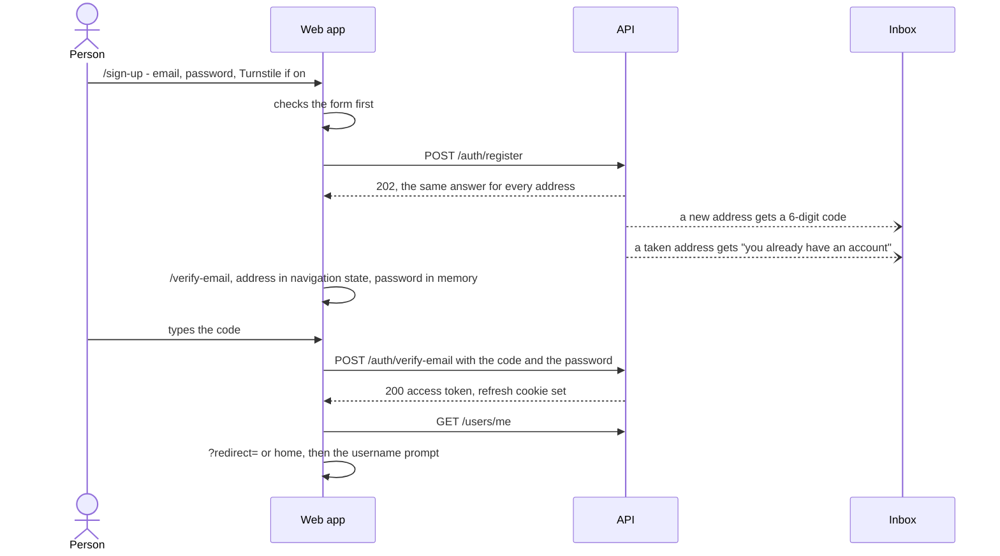
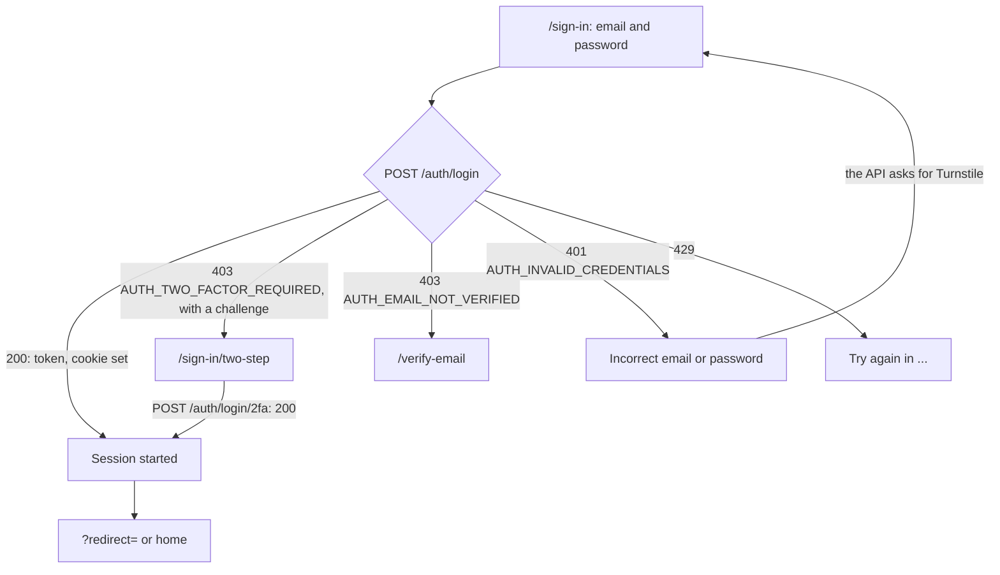
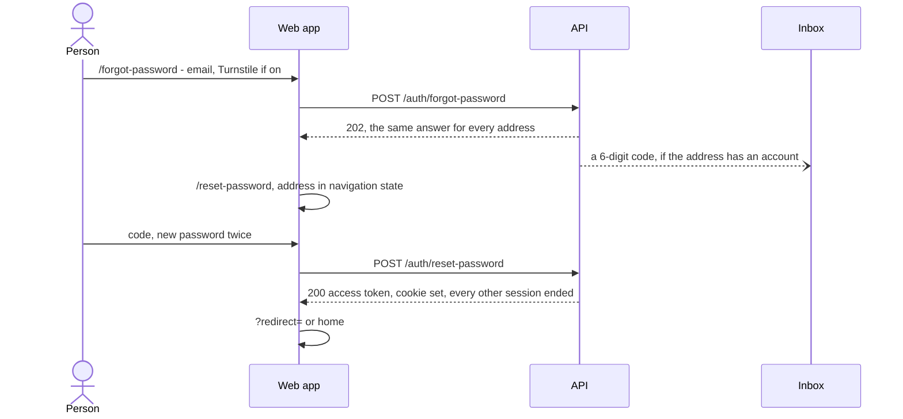
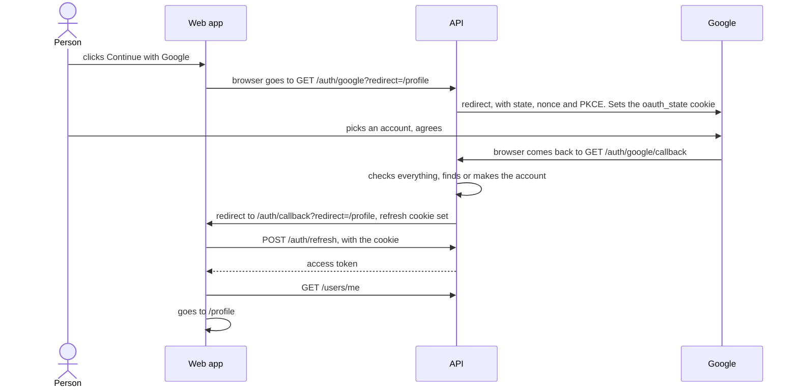

# The auth pages and flows

This page walks through every sign-in page of the web app: its address, who
may open it, what it shows, what it asks the API, and where it goes next. Read
it to understand what happens when someone clicks, or before changing a page.
For the session behind the pages, see [session.md](./session.md); for the
messages a form shows, [forms-and-errors.md](./forms-and-errors.md).

- [All the pages at a glance](#all-the-pages-at-a-glance)
- [Where the person goes afterwards: `?redirect=`](#where-the-person-goes-afterwards-redirect)
- [What one page hands the next](#what-one-page-hands-the-next)
- [Sign up](#sign-up)
- [Confirm the email address](#confirm-the-email-address)
- [Sign in](#sign-in)
- [Two-step sign-in](#two-step-sign-in)
- [Forgot and reset the password](#forgot-and-reset-the-password)
- [Continue with Google](#continue-with-google)
- [Already signed in: what visitor pages do](#already-signed-in-what-visitor-pages-do)
- [Pages for signed-in people](#pages-for-signed-in-people)
- [The header](#the-header)
- [After the first sign-in: the username](#after-the-first-sign-in-the-username)

## All the pages at a glance

The routes are in [routes.tsx](../../src/features/auth/routes.tsx), the paths
in [paths.ts](../../src/features/auth/lib/paths.ts) (`AUTH_PATHS`). Each page is
loaded only when first opened (`lazy`).

| Path | Who may open it | What it does | Asks the API | Goes next |
|---|---|---|---|---|
| `/sign-in` | visitors | Email and password; "Continue with Google" | `POST /auth/login` | `?redirect=` or home; the two-step page; the confirm page |
| `/sign-up` | visitors | Email, password, confirmation; the rules ticked off as you type | `POST /auth/register` | always the confirm page |
| `/verify-email` | visitors | The 6-digit code from the email. The right code signs in | `POST /auth/verify-email`, `POST /auth/resend-verification` | `?redirect=` or home; the two-step page |
| `/forgot-password` | visitors (a signed-in person sees a card) | Asks for a code to choose a new password | `POST /auth/forgot-password` | always the reset page |
| `/reset-password` | visitors (a signed-in person sees a card) | The code and a new password. Signs in, and signs out every other device | `POST /auth/reset-password` | `?redirect=` or home; the two-step page |
| `/sign-in/two-step` | visitors | The second step: a code from the authenticator app, or a recovery code | `POST /auth/login/2fa` | `?redirect=` or home |
| `/auth/callback` | anyone | Where the API sends the browser back after Google | `POST /auth/refresh` | `?redirect=` or home; the two-step page; or says why it failed |
| `/settings` | signed in | Password, two-step sign-in, sign out everywhere ([account-settings.md](./account-settings.md)) | several | stays |
| `/profile` | signed in | The profile, and "Delete account" ([account-settings.md](./account-settings.md#delete-the-account)) | several | stays |

"Visitors" means the page is wrapped in `GuestOnlyRoute`: a signed-in person
is sent on ([below](#already-signed-in-what-visitor-pages-do)). "Signed in"
means `ProtectedRoute`: a visitor is sent to sign in and brought back
afterwards ([below](#pages-for-signed-in-people)).

## Where the person goes afterwards: `?redirect=`

Someone who opens `/profile` while signed out should land on `/profile` once
signed in, even if they first sign up, confirm their address and enter a
two-step code. The page they were heading for travels in the address as
`?redirect=`:

1. `ProtectedRoute` sends them to `/sign-in?redirect=%2Fprofile`. The header's
   "Sign In" link does the same with the current page.
2. Every link between auth pages keeps it (`withRedirect()` in `paths.ts`):
   sign-in → sign-up → confirm, sign-in → forgot → reset, and the two-step
   page.
3. "Continue with Google" hands it to the API, which hands it back on
   `/auth/callback`.
4. Once signed in, the page goes to `safeRedirect(redirect)`, with `replace`,
   so the browser's Back button does not return to a sign-in page.

**`safeRedirect()` only allows a page on this site.** It returns the path
(with its query and `#` part) when the address resolves to this app's own
origin, and `/` otherwise. It also returns `/` for the sign-in pages
themselves: after signing in, `/sign-in` is a dead end. Why: without the check,
a link to `/sign-in?redirect=https://evil.example` would send someone to a
look-alike site straight after they signed in, where a "please sign in again"
page would collect their password. The API checks the address it gets from
Google's round trip in the same spirit.

## What one page hands the next

Pages pass the address typed so far, and what just happened, in the router's
**navigation state** (an invisible note attached to the history entry), never
in the address bar. [page-state.ts](../../src/features/auth/lib/page-state.ts)
holds the shapes:

| State | Set by | Read by | Meaning |
|---|---|---|---|
| `email` | sign-in ("Forgot your password?"), sign-up, forgot-password, "Use a different address" | the next page | Fill the address in, or show it as text |
| `notice: 'code-sent'` | sign-up, forgot-password | confirm, reset | "Check your inbox" |
| `notice: 'unverified'` | sign-in | confirm | "Your email isn't confirmed yet" |
| `challenge` | sign-in, confirm, reset | two-step | The API's one-off ticket for the second step |

Why not the address bar: an email address in the URL ends up in the browser's
history, the web server's access log and the page addresses error tracking
records. Navigation state lives in the tab only. A reload keeps it; a new tab
starts without it, which only means typing the address again. Pages check what
they read (`useAuthPageState`): a history entry can hold anything.

## Sign up

[SignUp.tsx](../../src/features/auth/pages/SignUp.tsx). Email, password (with
the [rules checklist](./forms-and-errors.md#the-password-rules)), and the
password again. When the API has Turnstile on, the widget is always on this
form. "Continue with Google" sits under it when the API offers Google.

Step by step:

1. The form checks the address, the password rules the browser knows, and that
   both passwords match. Nothing is sent until they pass.
2. `POST /auth/register` with `email`, `password` and, when shown, the
   Turnstile token (`turnstile_token`).
3. The API answers `202` whatever the address: new, already taken, or signed
   up but never confirmed. The page records that a code was sent (for the
   ["send another" timer](./forms-and-errors.md#send-another-code-timers)),
   keeps the password in memory for the confirm page
   ([sign-up-password.ts](../../src/features/auth/lib/sign-up-password.ts)), and
   moves to `/verify-email` with the address.

**The page always moves on.** It cannot, and must not, say "this address
already has an account": that would let anyone test which addresses have
accounts here (*enumeration*). The owner of a taken address learns it from
their inbox instead: the API emails them how to sign in, and no code.

**When it is refused:**

| Refusal | What the page does |
|---|---|
| `422 AUTH_PASSWORD_REJECTED` | Marks the broken rules on the checklist, including the ones only the API checks (a common password). Keeps the solved Turnstile: the API checks the password before Turnstile, so the token was not used |
| `429` (too many sign-ups from this network, or emails to this address) | Says how long to wait. Keeps the Turnstile token: the limit refuses before Turnstile is asked |
| Turnstile errors | Says so; draws a fresh widget ([forms-and-errors.md](./forms-and-errors.md#turnstile)) |

Sent back from the confirm page with "Use a different address", the form opens
with that address filled in.

## Confirm the email address

[VerifyEmail.tsx](../../src/features/auth/pages/VerifyEmail.tsx), at
`/verify-email`. It arrives with the address, and either `code-sent` (from
sign-up) or `unverified` (sign-in found the address unconfirmed; maybe no code
is live).

- **The address is shown as text, not a field** ([SentTo.tsx](../../src/features/auth/components/SentTo.tsx)).
  A code works only for the account it was sent to, so editing the address
  here could only ever produce "that code isn't right". "Use a different
  address" goes back to where it was typed (sign-up, or sign-in for
  `unverified`), with the address filled in. SentTo also carries a hidden
  `autocomplete="username"` field, so a password manager files a new password
  under the right account.
- **Opened without an address** (a bookmark, a new tab), the page asks for it
  as a normal field.
- The code field has focus. Six digits; spaces are ignored.
- **The password from sign-up goes with the code.** The API asks for it:
  signing up again with an unconfirmed address replaces its password, and
  without it someone who knew your address could sign it up again with their
  own password and have you confirm their account. Sign-up (or sign-in, when it
  finds the address unconfirmed: the password was right) leaves the password
  in [sign-up-password.ts](../../src/features/auth/lib/sign-up-password.ts), a
  variable in memory, so normally only the code is typed. It is never put in
  storage, the URL or the history entry. After a reload it is gone, and the
  page shows a password field ("The password you chose when you signed up").

**Confirm:** `POST /auth/verify-email` with `email`, `code` and `password`.
A wrong code and a wrong password are one answer from the API
(`AUTH_CODE_INVALID`), so the page says "That code, or the password, isn't
right. Use the code from the newest email, and the password from your last
sign-up." The right pair confirms the address **and signs in**: the answer carries an access token and
sets the refresh cookie. The page starts the session
([session.md](./session.md#starting-a-session)), shows "Your email is
confirmed. Welcome!", and goes to `?redirect=` or home. A first sign-in then
shows the [username prompt](#after-the-first-sign-in-the-username).

With two-step sign-in on (an account that confirmed long ago and turned it
on), the API answers `403 AUTH_TWO_FACTOR_REQUIRED` instead: the address is
confirmed, and the page moves to the two-step page.

**Send a new code:** `POST /auth/resend-verification`. The button waits out
the minute since the last code went to this address, counted from the real
send time, even across a reload
([timers](./forms-and-errors.md#send-another-code-timers)). The answer is the
same for every address, so the message is "If this address has an account, a
new email is on its way. Only the newest code works."

**A wrong code** says "That code isn't right. If you asked for more than one,
only the newest works." A code that expired (10 minutes) or had 5 wrong tries
says to ask for a new one.

## Sign in

[SignIn.tsx](../../src/features/auth/pages/SignIn.tsx), at `/sign-in`. Email,
password (with a show/hide button), "Forgot your password?", "Create one", and
"Continue with Google" when the API offers it.

1. The form checks the address is an address and the password is not empty.
   It does not check the password rules: an old password may predate them, and
   the API does not check them at sign-in either.
2. `signIn()` in the store sends `POST /auth/login` with `email`, `password`
   and, when shown, the Turnstile token.
3. On `200` the store starts the session; the page goes to `?redirect=` or
   home.

**Every other answer:**

| Answer | What the page does |
|---|---|
| `403 AUTH_TWO_FACTOR_REQUIRED` | The password was right; the account has two-step sign-in on. Goes to `/sign-in/two-step`, the challenge in navigation state |
| `403 AUTH_EMAIL_NOT_VERIFIED` | The password was right; the address was never confirmed. Goes to `/verify-email` with the address and `unverified`, rather than a dead end |
| `401 AUTH_INVALID_CREDENTIALS` | "Incorrect email or password." The same for a wrong password and an address with no account, so the page says nothing about which addresses exist. When Google is on, it adds: "Signed up with Google? Use Continue with Google below..." (shown to everyone, so it reveals nothing either) |
| `captcha_required` on that answer | The API wants Turnstile from the next attempt (after two failures). The widget appears. Most people never see it |
| `429` | Too many failed sign-ins for this address, or from this network: says how long to wait |
| `503 AUTH_CAPTCHA_UNAVAILABLE` | Cloudflare could not be reached: try again in a minute |

"Forgot your password?" carries the address typed so far to the next page.
A page that sends someone here may hand over an address; it is filled in.

## Two-step sign-in

[TwoStep.tsx](../../src/features/auth/pages/TwoStep.tsx), at
`/sign-in/two-step`. For an account with two-step sign-in on: the password (or
Google, or an emailed code) was right, and the API answered with a
**challenge** instead of a session. Turning it on is in
[account-settings.md](./account-settings.md#two-step-sign-in).

It is reached from four places:

| From | The challenge travels |
|---|---|
| Sign-in | in navigation state, from the `403`'s `data.challenge` |
| Confirming the address | same |
| Resetting the password (the new password is already saved) | same |
| Google | in an httpOnly cookie, `two_factor`, which only the API reads. The callback page arrives with `?two_factor=1`, never the challenge itself |

**What the person does:**

1. Types the 6 digits the authenticator app shows. Or chooses "Use a recovery
   code instead" and types one (`XXXXX-XXXXX`; the dash and the case do not
   matter).
2. The page checks the shape, then sends `POST /auth/login/2fa` with `code`
   and `challenge` (left out after Google: the API reads its cookie).
3. The answer is like a sign-in: an access token and the refresh cookie. The
   page starts the session and goes to `?redirect=` or home.

**The limits, and what the page shows:**

| Answer | The page |
|---|---|
| `400 AUTH_TWO_FACTOR_CODE_INVALID` | "That code isn't right. 2 tries left." Empties the field, keeps the form |
| The last try used, or `401 AUTH_TWO_FACTOR_CHALLENGE_EXPIRED` | The challenge lasts 5 minutes and allows 5 wrong codes. The form goes; the link reads "Sign in again" |
| `429` with reason `wrong_codes` | The account also allows 5 wrong codes per 15 minutes, across sign-ins. The form goes; the message says how long to wait, since signing in again at once would only be refused |
| `503 AUTH_TWO_FACTOR_UNAVAILABLE` | The API cannot open this account's secret: "Contact support." The form stays |

A recovery code works once. The API emails the owner when one is used, with
how many are left.

Where to go afterwards is in the address (`?redirect=`), not in navigation
state: the moment the session starts, `GuestOnlyRoute` sends the now
signed-in person on to `?redirect=`.

## Forgot and reset the password

**`/forgot-password`** ([ForgotPassword.tsx](../../src/features/auth/pages/ForgotPassword.tsx)):

1. The address (filled in when handed over). The Turnstile widget, always,
   when the API has it on.
2. `POST /auth/forgot-password` with `email` and the token. The API answers
   `202` whether or not the address has an account, so the page always moves
   on to `/reset-password`.
3. "Send code" stays disabled, with a countdown, for what is left of the
   minute since the last code went to that address in this tab, and for as
   long as a `429` asks.

**`/reset-password`** ([ResetPassword.tsx](../../src/features/auth/pages/ResetPassword.tsx)):

1. The address as text (SentTo; "Use a different address" goes back to
   forgot-password), or a field when opened without one.
2. The code, the new password with the checklist, the new password again. A
   line says "Every other device is signed out, and you stay signed in here."
3. `POST /auth/reset-password` with `email`, `code` and `password`. The API
   saves the password, ends **every** session of the account, and signs in
   here: an access token and a new refresh cookie.
4. The page starts the session, says "Password changed. You're signed in, and
   every other device was signed out.", and goes to `?redirect=` or home.

With two-step sign-in on, the password is changed all the same, and the page
moves on to the two-step page ("Enter your two-step code to finish signing
in").

"No email? Send another code" links back to forgot-password with the address;
until the minute is up it reads "Send another code in 42 s" instead.

An account made with Google has no password. "Forgot password" works for it
too: the email offers to choose one, and the reset sets the first password.

Both pages are opened from email links, so a signed-in person who opens them
gets a card rather than being sent away ([below](#already-signed-in-what-visitor-pages-do)).

## Continue with Google

Signing in with Google is a **page navigation, not an API call**: the browser
leaves the app, visits the API and Google, and comes back. The button is in
[OAuthButtons.tsx](../../src/features/auth/components/OAuthButtons.tsx), the
address and the error names in [oauth.ts](../../src/features/auth/lib/oauth.ts),
the return page in [OAuthCallback.tsx](../../src/features/auth/pages/OAuthCallback.tsx).

**The button appears only when the API offers Google.** The app reads
`GET /auth/options` once per page load ([auth-options.ts](../../src/features/auth/api/useAuthOptions.ts));
the button shows when its `providers` list has `google`. While that loads, or
if the API cannot be asked, there is no button: no button beats a button that
leads nowhere. It is a plain link (`<a href>`) to
`${VITE_API_URL}/auth/google?redirect=<path>`, on the sign-in and sign-up pages.

**The return page, `/auth/callback`.** On success the API has set the refresh
cookie and nothing else, so the page does what a reload does: trades the
cookie for an access token (`resumeFromCookie()`,
[session.md](./session.md#starting-a-session)), loads the user, tells the
other tabs, and goes to `safeRedirect(?redirect=)` with `replace` (Back does
not return to the callback). It runs once, even though React runs effects
twice in development.

What the page reads from its address:

| Query | Meaning | The page |
|---|---|---|
| `?error=cancelled` | The person cancelled at Google | "Sign-in with Google was cancelled." and "Back to sign in" |
| `?error=email_unverified` | Google has not verified the account's address | "Google hasn't verified this account's email address, so it can't be used to sign in here." |
| `?error=account_deleted` | The account linked to this Google account was deleted | "The account linked to this Google account has been deleted." |
| any other `?error=` | Something failed (the API logged why) | "Sign-in with Google didn't work. Try again, or sign in with your email." |
| `?two_factor=1` | Two-step sign-in is on; the API kept the challenge in a cookie | Goes to `/sign-in/two-step`, keeping `?redirect=` |
| `?notice=password_removed` | Someone had signed up with this address and a password but never confirmed it; linking Google removed that password | A message for 15 seconds, which also says how to set a password in Settings |
| none of these | Success | Takes up the session as above. No session to take up: the "didn't work" message |

"Back to sign in" keeps `?redirect=`.

Which account a Google sign-in lands in (a new one, or an existing one with
the same address) is the API's decision: the API starter's
`docs/auth/google-sign-in.md`. A new account made with Google has no username,
so the [username prompt](#after-the-first-sign-in-the-username) follows, and no
password, so Settings offers to [set one](./account-settings.md#set-a-first-password).

Turning Google on is the API's business alone (`GOOGLE_CLIENT_ID` and
`GOOGLE_CLIENT_SECRET` there; the API starter's `docs/setup/google-sign-in.md`).
Nothing in this app's Content-Security-Policy is needed: following a link to
another site is not something it governs, and Google's pages never load inside
this app.

## Already signed in: what visitor pages do

`GuestOnlyRoute` ([ProtectedRoute.tsx](../../src/features/auth/components/ProtectedRoute.tsx))
wraps the visitor pages. A signed-in person who opens one:

- `/sign-in`, `/sign-up`, `/verify-email`, `/sign-in/two-step`: is sent on, at
  once, to `safeRedirect(?redirect=)`, or home.
- `/forgot-password` and `/reset-password`: these are the pages emails link
  to, so the person may well be signed in to another account. They see a card
  instead: "You're already signed in", "You're signed in as you@example.com",
  a line on using Change password in Settings, and two buttons: **Go to
  Settings**, and **Sign out and continue** (signs out and reloads the same
  page, now as a visitor).

The card shows only when the person was signed in on arrival. Signing in on
the page itself (a reset signs in) moves on as usual.

`/auth/callback` is not guarded: it is the page that makes the visitor signed
in.

## Pages for signed-in people

`ProtectedRoute` wraps `/settings` and `/profile`. A visitor is sent to
`/sign-in?redirect=<the whole address>` (path, query and `#` part), and comes
back there after signing in. While a sign-out is reloading the app, it shows a
spinner instead, so the person does not flash through the sign-in page on the
way out ([session.md](./session.md#signing-out-step-by-step)).

## The header

[MainLayout.tsx](../../src/app/layout/MainLayout.tsx):

- **Signed out:** a "Sign In" button. It goes to `/sign-in?redirect=<this page>`,
  except on the home page and the sign-in pages themselves, where it goes to
  plain `/sign-in`.
- **Signed in:** the avatar opens a menu with the display name and
  `@username`, then **Profile**, **Settings** and **Log out**. Log out shows
  "Logging out..." and [signs out](./session.md#signing-out-step-by-step) to
  the home page.

## After the first sign-in: the username

A new account has no username: one made with the sign-up form, and one made
with Google. Right after the first sign-in, a dialog asks for one, and cannot
be closed until it is set (it offers "Not you? Sign out"). The full story:
[../username-prompt.md](../username-prompt.md).
