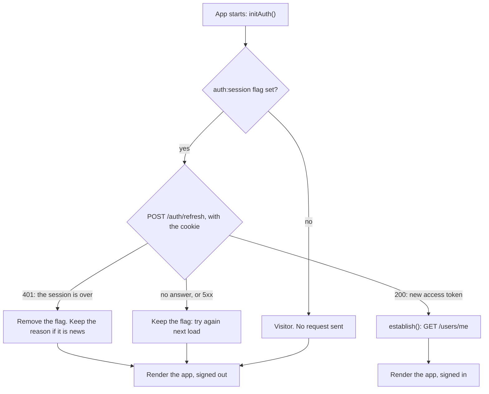

# The session in the browser

This page explains how the web app stays signed in: where the session lives,
what happens on a page load, how a request gets a fresh token, what the API
client does when the API refuses one, how open tabs stay in step, and every
reason a session ends with what the person then sees. Read it before touching
`auth.store.ts` or `src/lib/api.ts`, or when someone is signed out and you
want to know why.

- [In plain words](#in-plain-words)
- [Where everything lives](#where-everything-lives)
- [Starting a session](#starting-a-session)
- [A page load](#a-page-load)
- [Getting a token for a request](#getting-a-token-for-a-request)
- [How the API client handles answers](#how-the-api-client-handles-answers)
- [Which requests carry what](#which-requests-carry-what)
- [Several tabs](#several-tabs)
- [Signing out, step by step](#signing-out-step-by-step)
- [Why a session ended: every reason](#why-a-session-ended-every-reason)
- [An account waiting to be deleted](#an-account-waiting-to-be-deleted)
- [The numbers the API decides](#the-numbers-the-api-decides)

## In plain words

At sign-in the API hands out two things:

- an **access token**: a short-lived pass (15 minutes by default). The app
  sends it with every request, as `Authorization: Bearer <token>`. The app
  keeps it in a variable in memory, so it is gone when the tab closes or
  reloads;
- a **refresh token**, in a cookie the API sets. The cookie is *httpOnly*: no
  script on the page can read it, this app's code included. The browser sends
  it to the API's `/auth` routes by itself.

When the access token is about to run out, or after a reload, the app calls
`POST /auth/refresh`. The browser attaches the cookie; the API answers with a
new access token and a new cookie (the old one stops working: *rotation*).
The person notices nothing.

**Why not keep the access token in `localStorage`?** Any script running on
the page can read `localStorage`. One cross-site scripting bug (XSS), or one
compromised package, and the token is stolen. In memory it lives as long as
the tab, and the cookie, which scripts cannot read at all, brings the session
back after a reload.

## Where everything lives

| What | Where | Who can read it | How long |
|---|---|---|---|
| The access token, and when it expires | a module variable in [access-token.ts](../../src/features/auth/lib/access-token.ts) | this tab's code | as long as the API says (`expires_in`), or until the tab reloads |
| The refresh token | the cookie `refresh_token`, httpOnly, sent only to the API's `/api/v1/auth` routes | the browser and the API, never a script | the session: 30 days by default, never extended by refreshing |
| "This browser may be signed in" | `localStorage`, key `auth:session`, value `"1"` | any script; it is not a secret | until a sign-out, or a refresh the API refuses |
| Who is signed in (`id`, `email`, `username`, `displayName`, `roles`) | the store, [auth.store.ts](../../src/features/auth/auth.store.ts) (`useAuthStore`) | this tab | until sign-out |
| The full profile | the React Query cache, key `['users', 'profile']` | this tab | cleared at sign-out |
| Why the last session ended | `sessionStorage`, key `auth:sign-out-reason` | this tab | until said once: by a toast after the reload, or by the sign-in page's banner; then removed |
| When the account goes, if it waits to be deleted | the store's `deletesAt` while signed in (from the profile's `deletes_at`); `sessionStorage`, key `auth:deletes-at`, after a sign-out with the reason `account-deleted` | this tab | the store's until restored or signed out; the stored one goes with the reason ([below](#an-account-waiting-to-be-deleted)) |

**Why the `auth:session` flag is not a security problem.** It is not the
session; the cookie is. The flag only decides whether a page load asks the API
for a token at all. Without it, every visitor who never signed in would cost a
refused `/auth/refresh` on every page load. A wrong flag costs one refused
request, and is then removed.

## Starting a session

Every way in ends in the same private step of the store, `establish()`:

1. Keep the access token in memory (when one came with the answer).
2. Set the `auth:session` flag.
3. Mark the store signed in (`isAuthenticated: true`), and set `isComplete`
   from what the sign-in said about the account (the emailed code's answer
   carries `account.completed`; otherwise it counts as complete).
4. Ask `GET /users/me` who this is. Put the answer in the profile cache, so
   your menu, the profile page and "complete your account" do not ask again,
   keep the short form as `user`, take `isComplete` from the profile's
   `completed` and `deletesAt` from its `deletes_at` (null unless the account
   waits to be deleted, [below](#an-account-waiting-to-be-deleted)). Tell error tracking the user's id (only the id:
   [../error-tracking.md](../error-tracking.md)).

If `/users/me` fails, the person is signed in all the same; the profile query
tries again by itself. Should the account be incomplete after all, the API's
first `403 ACCOUNT_INCOMPLETE` corrects `isComplete`
([below](#how-the-api-client-handles-answers)), and the routes open `/welcome`
([pages-and-flows.md](./pages-and-flows.md#the-gate-an-incomplete-account-sees-only-welcome)).

| How | Called by | What arrives |
|---|---|---|
| `signIn(email, password)` | the sign-in page | `POST /auth/login` answers with tokens; then `startSession` |
| `startSession(tokens, account?)` | `/verify` (the emailed code) and the reset page (their answer is like a sign-in's) | tokens in the answer body; from `/verify`, also `account: { created, completed }`. Tells the other tabs `signed-in` |
| `resumeFromCookie()` | `/auth/callback`, after Google | only the cookie: it calls `POST /auth/refresh` first. Tells the other tabs `signed-in`. Resolves `false` when there was no session |
| `initAuth()` | `App.tsx`, once per page load | only the cookie, as above ([next section](#a-page-load)) |

## A page load

The access token was in memory, so after a reload there is none.
[App.tsx](../../src/app/App.tsx) calls `initAuth()` once, and shows a spinner
until it finishes, so no page renders as "signed out" for a moment and then
flips.

Once the app has rendered, it shows a toast for a sign-out reason left in
`sessionStorage`, if the reason is one said by a toast; a session that ended
by itself or elsewhere is left for the sign-in page's banner
([below](#why-a-session-ended-every-reason)).

A session that ended while the app was closed (the password was changed on
another device, say) is found here: the refresh is refused with a reason. The
page load keeps that reason so the person is told, except for a plain expiry
or a plain sign-out, which nobody needs telling about.

## Getting a token for a request

Every request through the API client asks the store for a token:
`getToken()`.

1. Not signed in: no token. The request goes out without one.
2. The token in memory has more than **60 seconds** left: use it. The margin
   means a request never leaves with a token that expires on its way.
3. Otherwise refresh first (`POST /auth/refresh`), then use the new token.

**One refresh at a time.** A page's queries often find the token expiring at
the same moment. They all wait for the same refresh (`refreshOnce()`, a
single shared promise) instead of each sending one. Each refresh uses the
cookie up, so duplicates would be wasted; the API would forgive them anyway
(two refreshes with the same cookie within 10 seconds count as the same
browser).

**When the refresh fails:**

| The refresh answer | Means | `getToken()` |
|---|---|---|
| `401` | The session is over (signed out elsewhere, password changed, expired, deleted account) | Clears the token, remembers the API's `data.reason`, and [signs out](#signing-out-step-by-step) with it |
| No answer, or a `5xx` | The API is down or unreachable. That says nothing about the session | Keeps the session. Sends the old token if it has not quite expired; otherwise none, and the request fails on its own |

## How the API client handles answers

[src/lib/api.ts](../../src/lib/api.ts) is the one axios client every feature
uses. It imports nothing from auth: it asks an `ApiSession` for the token, a
refresh, and to sign out, and tells it when the account is incomplete
(`accountIncomplete()`) or waits to be deleted (`pendingDeletion(deletesAt)`);
[main.tsx](../../src/main.tsx) connects the auth
store to it (`connectApiSession(apiSession)`, the adapter being
[api-session.ts](../../src/features/auth/lib/api-session.ts)). On the way out it
adds the token (above) and turns the body's and the query's keys into
snake_case. On the way back it turns the answer's keys into
camelCase, and looks at every refusal:

| The answer | What it means | What the client does |
|---|---|---|
| No answer at all (network, CORS, timeout) | Nothing about the session | Nothing; the request fails |
| A refusal of an auth route (`skipAuth`: login, email-code, refresh...) | An answer for the page: a wrong password is a `401` too | Nothing; the page handles it ([forms-and-errors.md](./forms-and-errors.md)) |
| Any refusal while nobody is signed in | Nothing to end | Nothing |
| `401 AUTH_TOKEN_EXPIRED` or `AUTH_TOKEN_INVALID` | The token aged, or became unreadable (a laptop woken from sleep, a clock that drifted, the API's `JWT_SECRET` changed). The session may be fine | Refreshes, then **retries the request once** with the new token (marked `authRetried`, so it can never loop). The person sees nothing. If the refresh finds the session over, signs out with the reason the refresh gave. If the API could not be asked, fails this request and keeps the session |
| `401 AUTH_TOKEN_REVOKED` | This tab's session ended. Usually elsewhere, but another tab of this browser may have reset the password with a code (D-74): that ended this session and left a newer one in the shared cookie | The same as above (the three codes make up `REFRESHABLE`): one refresh with the shared cookie, and the request retried with the new token if it works. If the refresh is refused, signs out with the reason the refresh gave. Signing out at once instead would end the newer session too, since the logout call sends the cookie |
| Any other `401` (`AUTH_TOKEN_MISSING`, or refused again after the retry) | The session ended | Signs out, with the reason from the answer's `data.reason` |
| `403 AUTH_ACCOUNT_DISABLED` | The account was deleted | Signs out (`account-disabled`) |
| `403 ACCOUNT_INCOMPLETE` | The account has not done "complete your account" (D-61); the session is fine | Calls `accountIncomplete()`, which is the store's `markIncomplete()`; the route guards then open `/welcome`. The request still fails for its caller |
| `403 ACCOUNT_PENDING_DELETION` | The account waits to be deleted and has not been restored (D-141); the session is fine but can only read the profile or restore | Calls `pendingDeletion(data.deletes_at)`, which is the store's `markPendingDeletion()`; the route guards then open the sign-in page under the restore dialog ([below](#an-account-waiting-to-be-deleted)). Not a sign-out. The request still fails for its caller |
| Any other `403` | Signed in, but not allowed to do *this* | Nothing; the page shows the error. Signing out would throw away the session and whatever the person was doing |
| `429`, `5xx`, anything else | Not about the session | Nothing |

The client does not add an `Idempotency-Key`: a key made here would differ on
every retry, so the API could never recognise a repeat. Mutations that need
one use `useIdempotentMutation` ([../data-fetching.md](../data-fetching.md)).

## Which requests carry what

[auth.api.ts](../../src/features/auth/api/auth.api.ts) holds every call to the
API's `/auth` routes. Two request options matter:

- **`skipAuth`**: send no bearer token, and treat a `401` as an answer, not as
  a sign the session ended.
- **`withCredentials`**: let the browser send the refresh cookie with the
  request, and store the cookie an answer sets. Needed because the app and the
  API are on different origins (ports 3001 and 8888 in development,
  `app.` and `api.` hosts in production); a browser sends cookies across
  origins only when asked to.

| Routes | `skipAuth` | Bearer token | `withCredentials` | Why |
|---|---|---|---|---|
| `POST /auth/login`, `/email-code`, `/email-code/verify`, `/forgot-password`, `/reset-password`, `/refresh`, `/logout`; `GET /auth/options` | yes | no | yes | Public routes; some set or read the cookie. `/auth/logout` gives up after 5 seconds |
| `POST /auth/account/delete` | no | yes | yes | Signed in, and the answer clears the cookie |
| `POST /auth/complete-account`, `POST /auth/change-password`, `POST /auth/account/restore`; `GET /auth/sessions`, `DELETE /auth/sessions`, `DELETE /auth/sessions/{id}`; `GET /users/me` | no | yes | no | Ordinary signed-in requests. The app never ends this device's own session through the session routes, so its cookie stays |

## Several tabs

All tabs share the cookie, but each has its own access token in memory.
[tab-sync.ts](../../src/features/auth/lib/tab-sync.ts) keeps them in step with a
`BroadcastChannel` named `auth`, which carries two messages:

| A tab says | The other tabs |
|---|---|
| `signed-out` | A signed-in tab forgets its session at once and reloads at the home page, rather than showing the account until its next request is refused. It shows no message; only the tab that signed out says why |
| `signed-in` | A signed-out tab runs `initAuth()`: the flag is set now, so it trades the shared cookie for its own token |

Some embedded browsers have no `BroadcastChannel`. There, each tab finds out
on its next request instead.

Two tabs refreshing at the same moment send the same cookie twice. The API
treats that as the same browser for 10 seconds and gives both the same new
token, instead of suspecting a stolen cookie.

## Signing out, step by step

Everything goes through the store's `logout(reason?, to?, deletesAt?)`:

1. **Once only.** Several requests often fail together when a session is
   revoked (every query gets its `401`). The first call signs out; the rest do
   nothing until the next sign-in.
2. **Remember the reason** in `sessionStorage`, to say it after the reload.
   A sign-out without a reason removes any reason an earlier one left, so it
   is never said for this one. With `account-deleted`, the day the account
   goes is kept too (`auth:deletes-at`): the `deletesAt` given, or the one
   the last refused refresh carried.
3. **Forget the session in this tab:** clear the access token, remove the
   `auth:session` flag, mark the store signed out (and `isSigningOut`, so
   `ProtectedRoute` shows a spinner instead of bouncing through the sign-in
   page), clear the error-tracking user, and **clear the whole query cache**.
   One person's data must never show, or be reused, for whoever signs in next
   in this tab.
4. **Tell the other tabs** `signed-out`.
5. **End the session on the API**, if this tab was signed in:
   `POST /auth/logout`, which also clears the cookie. Best effort: if it fails,
   nothing in this browser holds a token for that session any more, and it
   ends by itself.
6. **Reload the app** (a full page load, not an in-app navigation) at `to`.
   Only a path on this site is accepted; anything else becomes `/`. A full
   load is the simplest way to be sure nothing of the old session stays in
   memory.
7. After the reload, `App.tsx` takes the reasons said by a toast and shows
   it; the sign-in page takes the rest and shows its banner.

Who calls it:

| Where | Reason | Lands on |
|---|---|---|
| Your menu's **Sign out** | none | home |
| **Sign out** in the AuthShell's footer, on `/welcome` | none | home |
| **Sign out and continue** on the "already signed in" card | none | the same page, now as a visitor |
| The delete-account dialog, once `POST /auth/account/delete` succeeded (with its `deletes_at`) | `account-deleted` | sign-in, without `?next` |
| The API client, on a `401` that ends the session | from the API's `data.reason` | see below |
| The API client, on `403 AUTH_ACCOUNT_DISABLED` | `account-disabled` | home |
| `getToken()`, when the refresh is refused | from the refresh's `data.reason` | see below |

"Not now" in the restore dialog does not call `logout`: it uses
`setRestoreAside()`, which forgets the session without a reload
([below](#an-account-waiting-to-be-deleted)).

## Why a session ended: every reason

The reasons are in [sign-out-reason.ts](../../src/features/auth/lib/sign-out-reason.ts);
which are said by the sign-in page's banner and which by a toast, in
[sign-out-notice.ts](../../src/features/auth/lib/sign-out-notice.ts)
(`sessionEndedOf`, `isSessionEnded`, `announceSignOut`; texts in
`src/i18n/locales/<language>/auth.json`, `sessionEnded`; `deletion.json`,
`banner`; and `api.json`); where each lands, in `afterSignOut()` in the store. The store
hands each reader only its kind: `takeSignOutReason(which)` takes the reason
only when `which(reason)` is true, and leaves it for the other reader
otherwise; `peekSignOutReason()` reads it without taking it.

The API says why a session ended in `data.reason` on a `401`
(`AUTH_TOKEN_REVOKED` from any signed-in route, `AUTH_REFRESH_FAILED` from
`/auth/refresh`). A revoked token is tried once more with a refresh (above),
so the reason the app keeps is usually the refresh's. The app maps it to its
own name:

| Reason in the app | The API's `data.reason`, or what happened | The message after the reload | Lands on |
|---|---|---|---|
| `session-expired` | none, `expired`, `revoked` (this device was signed out from another device's list of sessions, D-65), or one the app does not know | banner: "Your session has ended · sign in again to continue" | sign-in, then back to this page |
| `password-changed` | `password_changed`: the password was changed or reset on another device | banner: "Your password was just changed on another device · sign in with the new password" | sign-in by password (`?method=password`), then back |
| `signed-out-everywhere` | `signed_out_everywhere`: "Sign out the other devices" was chosen on another device (D-75) | banner: "One of your devices chose "Sign out the other devices" · sign in again" | sign-in, then back |
| `signed-out` | `signed_out`: this session was signed out somewhere the broadcast did not reach | banner: the same as `session-expired` | sign-in, then back |
| `security` | `security`: the refresh cookie was used twice, so the API suspects it was copied, and ended the session | banner: "Your session was closed to protect your account because it was in use in two places at once · sign in again, and change your password if that wasn't you" | sign-in, then back |
| `account-disabled` | `account_deleted` without `deletes_at` from a refresh (the account is gone), or `403 AUTH_ACCOUNT_DISABLED` from any route | toast: "This account has been deleted" (error) | home |
| `account-deleted` | the person asked to delete the account, here (the delete dialog), or `account_deleted` with `deletes_at` from a refresh: asked on another device (D-141) | banner, with the icon UserX: "Your account will be deleted for good on dd/mm/yyyy · sign in before then to restore it" (no banner if the day is missing) | sign-in, without `?next`: the pages are gone with the session |
| none | the person chose Sign out | no message | home |

"Sign-in, then back" means `/login?next=<this page's path, query and #>`
(`signInPath(next, method)`): a session that ended by itself, mid-task, brings
the person back to what they were doing, and the sign-in page's banner says
why ([pages-and-flows.md](./pages-and-flows.md#sign-in)). From a page outside
the app it is `/login` alone.

**Ended while the app was closed.** The page load's refresh is refused with
the reason. It is kept for `password-changed`, `signed-out-everywhere`,
`security`, `account-deleted` (with its day) and `account-disabled`; not for
`session-expired` or `signed-out`. The page they opened renders as for a
visitor: a signed-in-only page sends them to sign in, and back afterwards,
where the banner says why (and `password-changed` opens on the password);
`account-disabled` is a toast at once.

One detail: when the API client refreshes after a `401` (`REFRESHABLE`:
`AUTH_TOKEN_EXPIRED`, `AUTH_TOKEN_INVALID`, `AUTH_TOKEN_REVOKED`) and the
refresh then finds the session over, the reason comes from the refresh's
answer (`refreshToken()` in the store signs out with it), not from that first
`401`.

## An account waiting to be deleted

Asking to delete the account
([account-settings.md](./account-settings.md#delete-the-account)) deletes
nothing for 14 days (REQ-AUTH-09, D-141). Every session ends, and each device
lands on sign-in under the dated `account-deleted` banner (above). The
account stays whole: signing in again by password, code or Google opens a
real session on it, but the API refuses that session everything except
reading the profile and `POST /auth/account/restore`.

**How the app knows.** The store's `deletesAt` is set from the profile's
`deletes_at` at every sign-in (`establish()`), or by a `403
ACCOUNT_PENDING_DELETION` from any request (`markPendingDeletion`). While it
is set:

| Where | What happens |
|---|---|
| `ProtectedRoute` (the app's pages) | sends to `/login?next=<this page>`, as for a signed-out person |
| `GuestOnlyRoute` (the sign-in pages) | keeps the page as it is and shows the restore dialog over it, instead of sending the person on |
| Every sign-in page that signs in (`/login` by password, `/verify`, `/auth/callback` after Google, `/reset-password`) | goes to `afterSignIn({ completed, pendingDeletion }, search, method?)`, which is `/login` keeping `?next` and `?invite`, plus `?method=password` for a password. The email goes along as router state, so the form shows what was typed |

**The restore dialog** ([PendingDeletionDialog.tsx](../../src/features/auth/components/PendingDeletionDialog.tsx),
S-AUTH-03 `pending-deletion`), loaded lazily by `GuestOnlyRoute` with the
`deletion` words: "Your account is waiting to be deleted", then "Your account
will be deleted for good on dd/mm/yyyy (11 days left). ...". The days are
calendar days from when it opened, at least 1 (`deletionDaysLeft` in
[deletion-date.ts](../../src/features/auth/lib/deletion-date.ts)); the date
is in the browser's time zone, since nobody has said which account zone yet.

| Choice | What happens |
|---|---|
| **Restore account** | `restoreAccount()`: `POST /auth/account/restore`, `deletesAt` back to null, the profile read again, and the toast "Account restored". `GuestOnlyRoute` then sends the person on with `afterSignIn` (to `?next`, or home). A refusal shows in red in the dialog |
| **Not now**, Esc, or a click on the scrim | `setRestoreAside()`: forget the session in this tab (as step 3 of [signing out](#signing-out-step-by-step)), tell the other tabs `signed-out`, and call `POST /auth/logout`, best effort. No reload and no reason: the page stays, its form as typed, and the account still waits |

**Restored, the old devices stay signed out**: their refresh now reads the
reason `revoked`, worded like an expiry. Once the 14 days are over the
account is gone, and a refresh carries `account_deleted` without a day:
`account-disabled`, a toast.

## The numbers the API decides

The app follows these; it does not set them. The exact rules are in the API
starter's `docs/auth/sessions-and-tokens.md`.

| What | Default | Set on the API with |
|---|---|---|
| Access token lifetime | 15 minutes (the app refreshes 60 seconds before the end) | `JWT_ACCESS_TTL_SECONDS`, 60 to 3600 |
| Session lifetime, from sign-in, never extended | 30 days | `AUTH_SESSION_TTL_DAYS` |
| Two refreshes with the same cookie still count as one browser | 10 seconds | fixed |
| The refresh cookie | `refresh_token`, httpOnly, `SameSite=Lax`, path `/api/v1/auth` | `AUTH_COOKIE_SAMESITE`, `AUTH_COOKIE_SECURE` |

For the cookie to reach the API at all, the app and the API must share a site,
or the API must allow cross-site cookies: [README.md](./README.md#what-the-api-must-have).
