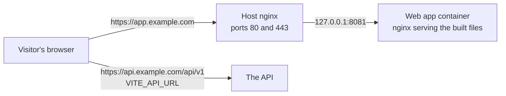

# Prepare for production

This page takes you from a working local setup to the web app live at
`https://app.example.com`, signing people in against your production API. It
is written for a first deploy: every step says what to do, why, and how to
check it worked.

`app.example.com` and `api.example.com` stand for your own names throughout.
Replace them everywhere, including in the commands.

- [Before you start](#before-you-start)
- [Step 1: Decide the names and where the app runs](#step-1-decide-the-names-and-where-the-app-runs)
- [Step 2: Point the site's name at the server](#step-2-point-the-sites-name-at-the-server)
- [Step 3: Get the server ready](#step-3-get-the-server-ready)
- [Step 4: Put the code on the server](#step-4-put-the-code-on-the-server)
- [Step 5: Fill in .env.production](#step-5-fill-in-envproduction)
- [Step 6 (optional): Error tracking](#step-6-optional-error-tracking)
- [Step 7 (optional): Let GitHub build the image, and the Deploy button](#step-7-optional-let-github-build-the-image-and-the-deploy-button)
- [Step 8: Put nginx and HTTPS in front](#step-8-put-nginx-and-https-in-front)
- [Step 9: Make the API accept this site](#step-9-make-the-api-accept-this-site)
- [Step 10: Deploy](#step-10-deploy)
- [Step 11: Check it from the outside](#step-11-check-it-from-the-outside)
- [Common mistakes](#common-mistakes)
- [Where to go next](#where-to-go-next)

## Before you start

- **The API comes first.** Follow the API starter's
  `docs/setup/prepare-for-production.md` until the API answers at
  `https://api.example.com/api/v1/health/live`. The web app can be deployed
  before that, but nobody can sign in until the API works.
- **You have done [prepare-for-development.md](./prepare-for-development.md)**,
  so you know the app works on your machine.
- **You can log in to the server over SSH**, as a user that is not root (for
  example `ubuntu`).

How the pieces fit together once you are done:



The browser downloads the app from `app.example.com`, then talks to the API
**directly**. The web app's server never sees a sign-in. That is why step 9,
on the API, matters as much as the steps here.

## Step 1: Decide the names and where the app runs

Write these down. You will type them several times.

| Decision | Recommended | Why |
|---|---|---|
| The web app's name | `app.example.com` (or `example.com`) | Anything works, as long as it is **on the same domain as the API** (next row) |
| The API's name | `api.example.com` | Same registrable domain (`example.com`) as the web app. The browser then treats the two as the *same site*, and the sign-in cookie works with the API's defaults. On two different domains it needs extra settings and still fails in Safari (step 9) |
| The server | The same one as the API | The web app is small (its container is capped at 128 MB of memory). One server, one nginx, one certificate tool. Another server works too: it just needs its own copy of [../server.md](../server.md) |
| Who builds the image | `build` (the server) to start; `registry` (GitHub) once [github.md](./github.md) is done | Building on the server needs nothing else, but takes a few minutes and a lot of memory for a moment. With `registry` the server only downloads |

**You are done when** you have the two names, the server's IP address, and a
choice of `build` or `registry`.

## Step 2: Point the site's name at the server

Browsers find your server by its name through DNS. You need one record for the
web app.

1. Open your DNS provider's dashboard (where you manage `example.com`). With
   Cloudflare: **Domains** → your domain → **DNS** → **Records** →
   **Add record**.
2. Fill in:
   - **Type**: `A`
   - **Name**: `app` (for `app.example.com`; `@` for the bare `example.com`)
   - **IPv4 address**: the server's IP
   - With Cloudflare, **Proxy status**: **DNS only** (the grey cloud) for now.
     The certificate in step 8 is easiest to get this way; you can turn the
     proxy on afterwards.
   - **TTL**: Auto
3. **Save**. If the server has an IPv6 address, add an `AAAA` record the same
   way.

The API starter's `docs/setup/domain-dns-tls.md` explains buying a domain,
moving it to Cloudflare, and what the proxy changes. If the screen differs
from the steps above, look for "DNS records" in your provider's menu: every
provider has the same three fields (type, name, address).

**You are done when** this prints the server's IP (it can take a few minutes,
rarely longer):

```bash
dig +short app.example.com          # or: nslookup app.example.com
```

## Step 3: Get the server ready

If the API already runs on this server, most of this is done. Check each item
anyway.

1. **The basics** from [../server.md](../server.md): security updates,
   firewall (only 22, 80 and 443 open), SSH keys only, fail2ban, and swap if
   the server will build the image.
2. **Docker Engine 25 or newer, with the compose plugin.** On Ubuntu, Docker's
   own script installs both:

   ```bash
   curl -fsSL https://get.docker.com | sudo sh
   sudo usermod -aG docker $USER        # lets your user run docker without sudo
   ```

   Log out and back in for the second line to take effect.
3. **git** and **flock** (deploy.sh needs both; Ubuntu has them already).
4. **A free port for the container.** The web app listens on
   `127.0.0.1:8081` (`FRONTEND_PORT`). The API uses `3000`, so they don't
   collide. If something else already uses 8081, pick another port and use it
   in steps 5 and 8.

**You are done when** these all answer without an error:

```bash
docker version --format '{{.Server.Version}}'    # 25.0 or higher
docker compose version
git --version && flock --version
ss -ltn | grep ':8081 ' || echo "8081 is free"
```

## Step 4: Put the code on the server

The server keeps a copy of the repository: `deploy.sh` runs from it and pulls
new commits into it.

1. If the repository is private, give the server a read-only **deploy key**
   first: [github.md](./github.md#step-5-let-the-server-clone-the-repository).
2. Clone it, into a folder next to the API's (for example `~/web` next to
   `~/nest`):

   ```bash
   git clone git@github.com:<owner>/<repository>.git ~/web
   cd ~/web
   ```

   (If you set up an SSH alias for the deploy key, use it instead of
   `github.com`: [github.md](./github.md#step-5-let-the-server-clone-the-repository).)

**You are done when** `git -C ~/web pull` says "Already up to date." without
asking for a password.

## Step 5: Fill in .env.production

The production settings live **on the server**, in `~/web/.env.production`.
Git ignores the file, and nothing else ever holds a copy. The container reads
it every time it starts, and writes the browser's settings into `/config.js`
([../deploy.md](../deploy.md)). So changing a value later needs only
`./deploy.sh`, never a new image.

```bash
cd ~/web
cp .env.example .env.production
chmod 600 .env.production      # only your user can read it
nano .env.production
```

Go through it line by line:

| Setting | Required? | What to write | Notes |
|---|---|---|---|
| `VITE_API_URL` | **Yes** | `https://api.example.com/api/v1` | The API's address **with** `/api/v1`, `https`, no trailing slash. The container refuses to start without it, and `deploy.sh` checks it before changing anything |
| `VITE_SENTRY_DSN` | No | The web project's DSN, or empty | Empty: no error tracking, and the browser downloads none of Sentry's code. Step 6 |
| `VITE_SENTRY_RELEASE` | No, leave it commented out | — | `deploy.sh` and CI set it to the commit being deployed |
| `SENTRY_ORG`, `SENTRY_PROJECT`, `SENTRY_AUTH_TOKEN` | No | Only with `DEPLOY_IMAGE_SOURCE=build`: see [sentry.md](./sentry.md#step-5-readable-stack-traces-sourcemaps) | All three or none. With `registry` they go in GitHub instead, and `deploy.sh` warns that these lines are ignored |
| `CSP_IMG_SRC` | No, leave it empty | — | See [the rule below](#csp_img_src-almost-always-empty) |
| `FRONTEND_PORT` | No | `8081` (the default) | Only if 8081 is taken (step 3). Must match the `--frontend-port` you give nginx in step 8 |
| `DEPLOY_IMAGE_SOURCE` | No | `build` (default) or `registry` | Step 1's choice |
| `DEPLOY_IMAGE` | Only with `registry` | `ghcr.io/<owner>/<repository>`, all lower case | With `build`, leave it out |
| `DEPLOY_KEEP_IMAGES` | No | `3` (default) | Releases kept for rollback; at least 2 in `build` mode |
| `DEPLOY_HEALTH_TIMEOUT` | No | `120` (default) | Seconds a new release has to become healthy |

The deploy settings are commented out in the template: remove the `# ` in
front of a line to set it.

Rules for the values:

- No spaces, quotes or backslashes in `VITE_*` values. The container refuses
  them rather than guess.
- A `$` in a value is read by Docker Compose as the start of a variable. Write
  it as `$$`, or put the whole value in single quotes. `deploy.sh` warns about
  any key whose value has one.
- `deploy.sh` also warns about keys nothing reads (usually a typo, which leaves
  the default in force) and keys set twice.

### CSP_IMG_SRC: almost always empty

The Content-Security-Policy is a header that tells the browser which servers
the page may load things from. This app's policy is built when the container
starts, from your settings: it already allows the API (`VITE_API_URL`), the
Sentry host (from `VITE_SENTRY_DSN`), and **images from any `https://`
address**.

Where do avatars come from?

| The API's storage | Avatar addresses look like | `CSP_IMG_SRC` |
|---|---|---|
| `STORAGE_TYPE=local` | `https://api.example.com/...` | Empty: the API is already allowed |
| AWS S3 or Cloudflare R2 | `https://<bucket>.s3.<region>.amazonaws.com/...` or `https://<account>.r2.cloudflarestorage.com/...` | Empty: `https:` is already allowed |
| A bucket served over plain `http` (a local RustFS, a test server) | `http://files.lan:9000/...` | Its origin, for example `http://files.lan:9000`. Several are separated by spaces |

On a real `https://` site an `http` image is "mixed content", which browsers
upgrade or block anyway, so the last row is really for testing the production
image on your own machine. In production, serve the bucket over `https` and
leave `CSP_IMG_SRC` empty.

**You are done when** `.env.production` has `VITE_API_URL` set to your API,
and every other line is either set on purpose or left as the template has it.

## Step 6 (optional): Error tracking

Without it, an error in a visitor's browser reaches nobody. Follow
[sentry.md](./sentry.md): it makes a Sentry project for the web app, and tells
you where each value goes:

- the DSN → `VITE_SENTRY_DSN` in `.env.production` (read when the container
  starts);
- for readable stack traces, `SENTRY_ORG` and `SENTRY_PROJECT` (GitHub
  variables) and `SENTRY_AUTH_TOKEN` (GitHub secret) if GitHub builds the
  image, or the same three lines in `.env.production` if the server does.

**You are done when** `VITE_SENTRY_DSN` is in `.env.production`, or you have
decided to go without for now.

## Step 7 (optional): Let GitHub build the image, and the Deploy button

With `DEPLOY_IMAGE_SOURCE=registry`, GitHub builds, tests and publishes the
image on every push to `main`, and the server only downloads it. The Deploy
button lets you deploy from the GitHub website. Both are set up in
[github.md](./github.md):

- the server logs in to GitHub's registry with a token that can only read
  packages ([github.md](./github.md#step-4-let-the-server-download-images));
- `.env.production` gets `DEPLOY_IMAGE_SOURCE=registry` and
  `DEPLOY_IMAGE=ghcr.io/<owner>/<repository>`;
- the Deploy button needs one secret and four variables
  ([github.md](./github.md#step-6-the-deploy-button)).

With `registry`, deploy only commits that are on `main` and whose CI run has
finished: only `main` publishes images.

**You are done when** you have either stayed with `build`, or the server can
pull the image of your latest `main` commit
(`docker pull ghcr.io/<owner>/<repository>:<first 12 characters of the commit>`).

## Step 8: Put nginx and HTTPS in front

The container listens only on `127.0.0.1:8081`, invisible from outside. The
**host's nginx** receives visitors on ports 80 and 443, holds the HTTPS
certificate, and passes requests to the container. The repository has a script
that sets this up once:

```bash
cd ~/web
sudo ./nginx/bootstrap-nginx.sh \
    --frontend-domain app.example.com \
    --email you@example.com
```

It installs nginx and certbot (if missing), writes the site's configuration to
`/etc/nginx/sites-available/react-app`, checks it, reloads nginx, asks Let's
Encrypt for a certificate, redirects HTTP to HTTPS, and turns on automatic
renewal.

Options you might need:

| Option | When |
|---|---|
| `--frontend-port 8082` | You changed `FRONTEND_PORT` in step 5 |
| `--site-name my-web` | You host several web apps on this server: each needs its own name. The API's script uses `nest-api`, so the default `react-app` does not clash with it |
| `--skip-certbot` | DNS does not resolve yet. Run it again without this flag later |

Two things must be true first: `dig +short app.example.com` gives this
server's IP (step 2), and port 80 is open (Let's Encrypt checks the name by
fetching a file over plain HTTP).

If you use Cloudflare's proxy: once the certificate exists you can turn the
record to **Proxied**, and then set **SSL/TLS** → **Overview** → encryption
mode to **Full (strict)**. Never use **Flexible**: Cloudflare would then talk
to your server over plain HTTP. The site's nginx configuration already reads
the visitor's real address from Cloudflare. If the screen differs, the API
starter's `docs/setup/domain-dns-tls.md` has more.

**You are done when:**

```bash
sudo certbot certificates                 # lists app.example.com, with an expiry date
curl -I https://app.example.com           # "502 Bad Gateway": expected, nothing is deployed yet
```

The point of the second command is that it answers **over HTTPS without a
certificate error**. The 502 goes away in step 10.

## Step 9: Make the API accept this site

The browser talks to the API directly, from the address `https://app.example.com`.
The API decides whether to answer by its **own** settings. Get these wrong and
the web app looks broken, while every log on this side looks fine. Open the
**API's** `.env.production` on its server and check each row:

| API setting | Must be | What breaks otherwise |
|---|---|---|
| `CORS_ORIGINS` | Contains `https://app.example.com` **exactly**: `https://`, no trailing slash, no path. Several addresses are separated by commas (for example `https://example.com,https://www.example.com` if the site answers on both) | The browser refuses every answer (a CORS error in the console), and the API refuses to refresh a session from an unknown address (`403 AUTH_FORBIDDEN`): people are signed out at every reload |
| `FRONTEND_URL` | `https://app.example.com` | The links and addresses in emails, and the return from Google, go to the wrong place. The API refuses to start in production without it |
| `CORS_CREDENTIALS` | `true` (or unset) | Production refuses `false`: the browser would never send the sign-in cookie |
| `AUTH_COOKIE_SAMESITE` and `AUTH_COOKIE_SECURE` | See the table below | People are signed out when their first access token expires (after 15 minutes by default, `JWT_ACCESS_TTL_SECONDS`) or at every reload |

### The sign-in cookie: same site or not?

After signing in, the API keeps the session in a cookie (the *refresh
cookie*), which the web app never sees: the browser sends it back to the API
by itself, to get a new access token. Browsers send a cookie from one address
to another only under rules called **SameSite**. Two addresses are the *same
site* when they share the registrable domain: `app.example.com` and
`api.example.com` do (`example.com`); `app.example.com` and `api.example.net`
do not.

| Web app | API | Same site? | API settings |
|---|---|---|---|
| `app.example.com` | `api.example.com` | Yes | The defaults: `AUTH_COOKIE_SAMESITE` unset (`lax`), `AUTH_COOKIE_SECURE` unset (on in production). Nothing to do |
| `example.com` | `api.example.com` | Yes | The defaults |
| `app.example.com` | `api.example.net` | **No** | `AUTH_COOKIE_SAMESITE=none`. The cookie must then be `Secure`, which is on in production; the API refuses to start with `AUTH_COOKIE_SECURE=false` and `none`. Even so, browsers that block third-party cookies (Safari by default, Firefox in strict mode, Chrome if the visitor chose it) drop the cookie, and those visitors are signed out at every reload. Prefer moving one of the two names so they share a domain |
| Two names on a shared hosting domain, such as `myapp.pages.dev` and `myapi.fly.dev` | | **No** | Such domains are on the browsers' "public suffix list", so each customer's name is its own site, even under the same parent. Use your own domain |

The API starter's `docs/auth/sessions-and-tokens.md` explains the cookie in
full.

### Google

If the API has Google sign-in on: nothing here. The address Google sends
people back to belongs to the API
(`https://api.example.com/api/v1/auth/google/callback`, registered in Google
Cloud as the API starter's `docs/setup/google-sign-in.md` says). The API then
sends them on to `FRONTEND_URL/auth/callback`.

After changing the API's env file, restart the API (in its folder:
`./deploy.sh`). It reads its settings only when it starts.

**You are done when** this, run from anywhere, shows both headers:

```bash
curl -s -i -H "Origin: https://app.example.com" https://api.example.com/api/v1/auth/options | grep -i '^access-control'
# access-control-allow-origin: https://app.example.com
# access-control-allow-credentials: true
```

No `access-control-allow-origin` line means `CORS_ORIGINS` does not contain
this site exactly.

## Step 10: Deploy

```bash
cd ~/web
./deploy.sh
```

What happens: `deploy.sh` checks the working tree is clean, pulls the branch,
checks `.env.production`, builds the image (or downloads it with `registry`),
starts it, waits until it answers, and only then marks it live. If the new
release does not become healthy, it starts the previous one again. The first
`build` takes a few minutes. Everything about it is in
[../deploy.md](../deploy.md).

**You are done when** it ends with `✓ Release <12 characters> is live`, and:

```bash
curl -I https://app.example.com                              # status 200
docker logs react-starter-auth-prod 2>&1 | grep runtime-config
# runtime-config: API https://api.example.com, error tracking off
```

The second line is what the container understood from `.env.production`. With
a DSN set it says `error tracking on (https://...)`.

## Step 11: Check it from the outside

Do these by hand once, in a private browser window. No test before the deploy
could have checked them. Tick each one.

**The site itself**

- [ ] `https://app.example.com` opens, and the browser console (F12) has no
      red error. A `Refused to ... Content Security Policy` message means the
      policy blocks something: the message names what.
- [ ] `curl -I https://app.example.com/config.js` says
      `Cache-Control: no-store, no-cache, must-revalidate`, and
      `curl https://app.example.com/config.js` shows your `VITE_API_URL`. A
      cached copy would keep browsers on an old address.
- [ ] `curl -sI https://app.example.com | grep -i content-security-policy`
      prints the policy, and its `connect-src` names `https://api.example.com`.
- [ ] Opening `https://app.example.com/settings/account` directly in a new tab
      goes to the sign-in page, and after signing in comes back to the Account
      page (deep links work through nginx).

**Sign-in, which needs the API (step 9)**

- [ ] Create an account on `/register` with a real address you can read. The
      code email arrives, the code signs you in, and "complete your account"
      (`/welcome`) opens the app.
- [ ] Reload: you are still signed in. (If not: step 9.)
- [ ] Leave the tab open longer than the access-token lifetime (15 minutes by
      default), then click to another page: still signed in. This is the
      refresh cookie crossing from `app.` to `api.`.
- [ ] If the API has Google on: **Continue with Google** takes you to Google
      and back, signed in.
- [ ] If avatars use S3 or R2: upload one on the Profile page
      (`/settings/profile`); it shows, and the
      console has no CSP error.
- [ ] Sign out works, and signing out on one tab signs out the others.

**Running it**

- [ ] If error tracking is on: in the console on the live site, run
      `setTimeout(() => { throw new Error('Sentry check') })`. The error appears
      in Sentry within a minute, under the `production` environment, with this
      release's commit ([sentry.md](./sentry.md#check-it-works)).
- [ ] An outside uptime check for `https://app.example.com/`, next to the
      API's (the API starter's `docs/setup/uptime-check.md`).
- [ ] After your second deploy: rehearse `./deploy.sh --rollback` while it is
      calm, then `./deploy.sh` to come forward again.
- [ ] Delete the test account (Settings → Account → Delete Account), or keep it as your
      own.

Do not run the end-to-end tests against production: they create accounts and
read codes from Mailpit ([../e2e-testing.md](../e2e-testing.md)).

## Common mistakes

| What you see | Cause | Fix |
|---|---|---|
| `deploy.sh` stops: `Set VITE_API_URL in .env.production` | The line is missing or empty | Step 5 |
| The container stops at once; its log says `runtime-config: ... must not contain quotes, backslashes or spaces` or `is not an http(s) URL` | A malformed value in `.env.production` | Fix the value named in the log, `./deploy.sh` again |
| `502 Bad Gateway` after the deploy | The container is not running, or nginx points at another port than `FRONTEND_PORT` | `docker ps`; compare `FRONTEND_PORT` with the port in `/etc/nginx/sites-available/react-app` |
| certbot fails: "check that DNS A-record ... points to this VPS" | DNS does not point here yet, port 80 is closed, or the Cloudflare proxy is on with a redirect rule | Step 2's check; open port 80; set the record to DNS only and run step 8 again |
| A CORS error on every API call in the console | `CORS_ORIGINS` on the API does not contain `https://app.example.com` exactly (often a trailing `/`, `http` instead of `https`, or `www.` missing) | Step 9, then restart the API |
| Signed in, but signed out again at every reload or after about 15 minutes | The refresh cookie does not reach the API: the site and the API are on different domains, or `CORS_ORIGINS` is wrong | Step 9's two tables |
| "Can't reach the server" on every form | `VITE_API_URL` is wrong (missing `/api/v1`, `http` instead of `https`), or the API is down | `curl https://app.example.com/config.js` and try that address plus `/health/live` |
| Links in the emails open `localhost` | The API's `FRONTEND_URL` | Step 9 |
| Odd failures in the browser when the site is opened over `http://` | The app needs HTTPS: some browser features it uses (`crypto.randomUUID`) exist only on secure pages | Always use `https://`; step 8 redirects HTTP for you |
| `Could not pull ghcr.io/...` | CI has not published that commit yet, or the server is not logged in to the registry | [github.md](./github.md#common-mistakes) |
| A changed `VITE_*` value has no effect | The container reads `.env.production` only when it starts | `./deploy.sh` |
| Errors don't reach Sentry | See [sentry.md](./sentry.md#common-mistakes) | |

## Where to go next

- Day-to-day deploys, rollbacks and the Deploy button: [../deploy.md](../deploy.md).
- Everything else the server needs: [../server.md](../server.md).
- Every setting in one table: [../environment.md](../environment.md).
- How sign-in works on this side: [../auth/README.md](../auth/README.md).
- Checking the site under load: [../load-testing.md](../load-testing.md).
