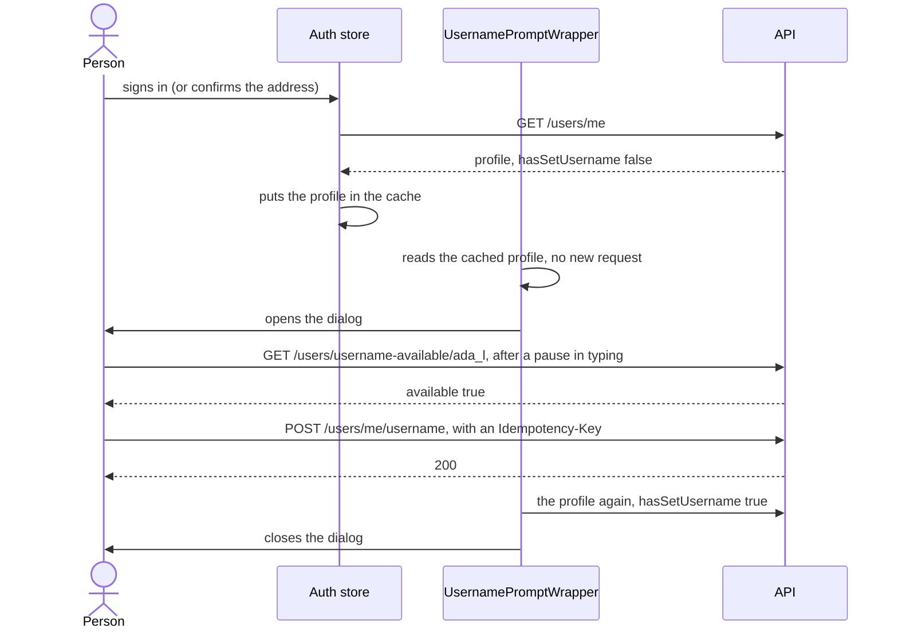

# The username prompt

A new account has no username: neither one made with the sign-up form nor one
made with "Continue with Google". Right after the first sign-in, a dialog asks
the person to choose one. This page explains when the dialog appears, how it
checks a name, what it asks the API, and how to change the rules. For the
sign-in pages around it, see [auth/pages-and-flows.md](./auth/pages-and-flows.md).

- [When it appears](#when-it-appears)
- [What the person sees](#what-the-person-sees)
- [Checking the name while it is typed](#checking-the-name-while-it-is-typed)
- [Saving it](#saving-it)
- [The API routes it uses](#the-api-routes-it-uses)
- [Changing the rules](#changing-the-rules)

## When it appears

`UsernamePromptWrapper` ([UsernamePromptWrapper.tsx](../src/features/users/components/UsernamePromptWrapper.tsx))
is rendered once, in `AppRoot` in [src/app/router.tsx](../src/app/router.tsx),
above every page. It reads the signed-in person's profile with `useProfile()`
and opens the dialog while `profile.hasSetUsername` is `false`.

Usually this costs no request: when a session starts, the auth store already
asks `GET /users/me` and puts the answer in the profile cache
([auth/session.md](./auth/session.md#starting-a-session)), which your menu,
the profile page and this wrapper all read.

Whether the dialog is open is worked out from the profile, not kept as a
separate switch. So when the username gets set anywhere (this tab or another),
the next time the profile is fetched the dialog closes by itself.

## What the person sees

[UsernamePromptModal.tsx](../src/features/users/components/UsernamePromptModal.tsx):
"Choose your username", "This will be your unique identifier. You can only set
it once!", a field, and **Confirm Username**.

- **It cannot be dismissed**: clicking outside and pressing Escape do nothing,
  and there is no corner close button (`hideCloseButton`). The username is a
  required step.
- **But it has a way out**: "Not you? Sign out" under the button. Someone
  signed in to the wrong account must not be trapped; it signs out to the home
  page.
- **The field filters as you type**: upper case becomes lower case, and
  anything other than `a`-`z`, `0`-`9` and `_` is dropped. At most 25
  characters.
- A spinner, a green tick or a red cross shows the availability check; "This
  username is already taken." under a taken name.

## Checking the name while it is typed

`useUsernameAvailability` ([useUsernameAvailability.ts](../src/features/users/api/useUsernameAvailability.ts)):

1. The name must match `USERNAME_PATTERN`, `^[a-z0-9_.]{2,32}# The username prompt

A new account has no username: neither one made with the sign-up form nor one
made with "Continue with Google". Right after the first sign-in, a dialog asks
the person to choose one. This page explains when the dialog appears, how it
checks a name, what it asks the API, and how to change the rules. For the
sign-in pages around it, see [auth/pages-and-flows.md](./auth/pages-and-flows.md).

- [When it appears](#when-it-appears)
- [What the person sees](#what-the-person-sees)
- [Checking the name while it is typed](#checking-the-name-while-it-is-typed)
- [Saving it](#saving-it)
- [The API routes it uses](#the-api-routes-it-uses)
- [Changing the rules](#changing-the-rules)

## When it appears

`UsernamePromptWrapper` ([UsernamePromptWrapper.tsx](../src/features/users/components/UsernamePromptWrapper.tsx))
is rendered once, in `AppRoot` in [src/app/router.tsx](../src/app/router.tsx),
above every page. It reads the signed-in person's profile with `useProfile()`
and opens the dialog while `profile.hasSetUsername` is `false`.

Usually this costs no request: when a session starts, the auth store already
asks `GET /users/me` and puts the answer in the profile cache
([auth/session.md](./auth/session.md#starting-a-session)), which your menu,
the profile page and this wrapper all read.

Whether the dialog is open is worked out from the profile, not kept as a
separate switch. So when the username gets set anywhere (this tab or another),
the next time the profile is fetched the dialog closes by itself.

## What the person sees

[UsernamePromptModal.tsx](../src/features/users/components/UsernamePromptModal.tsx):
"Choose your username", "This will be your unique identifier. You can only set
it once!", a field, and **Confirm Username**.

- **It cannot be dismissed**: clicking outside and pressing Escape do nothing,
  and there is no corner close button (`hideCloseButton`). The username is a
  required step.
- **But it has a way out**: "Not you? Sign out" under the button. Someone
  signed in to the wrong account must not be trapped; it signs out to the home
  page.
- **The field filters as you type**: upper case becomes lower case, and
  anything other than `a`-`z`, `0`-`9` and `_` is dropped. At most 25
  characters.
- A spinner, a green tick or a red cross shows the availability check; "This
  username is already taken." under a taken name.

## Checking the name while it is typed

`useUsernameAvailability` ([useUsernameAvailability.ts](../src/features/users/api/useUsernameAvailability.ts)):

: 2 to 32
   lower-case letters, digits, underscores or dots, the same rule as the API's
   (SRS REQ-AUTH-01).
   A shorter name is not checked at all.
2. After a 400 ms pause in typing, it asks
   `GET /users/username-available/<name>`.
3. Each answer is kept under the name it was asked for (and reused for 30
   seconds), and
   an answer is shown only for the exact name on screen. A slow answer for
   `ali` can never mark `alice` available, and after each keystroke the button
   stays disabled until the new name is checked.
4. If the check itself fails (offline, too many requests, the API down), it
   says "Couldn't check availability." with **Check again**, instead of
   leaving the button disabled with no reason.

## Saving it

`useSetUsername` ([useSetUsername.ts](../src/features/users/api/useSetUsername.ts)):

- **Confirm Username** is enabled only when the name on screen was checked and
  is available.
- It sends `POST /users/me/username` with `{ "username": "ada_l" }` and an
  `Idempotency-Key` header, so a double click or a retried request sets the
  name once ([data-fetching.md](./data-fetching.md)).
- On success: "Username set successfully", and the profile is fetched again;
  its `hasSetUsername: true` closes the dialog.
- `USERNAME_CONFLICT`: someone took the name between the check and the click.
  The field shows it as taken.
- `USERNAME_ALREADY_SET`: it was set meanwhile, in another tab. The profile is
  fetched again, and the dialog closes.
- Every failure also shows one toast, from the app-wide mutation error handler.

The username cannot be changed later: the API sets it once.

## The API routes it uses

| Method | Route | Purpose |
|---|---|---|
| GET | `/users/me` | The profile, with `has_set_username` (the app reads it as `hasSetUsername`) |
| GET | `/users/username-available/:username` | Whether a name is free: `{ available }` |
| POST | `/users/me/username` | Sets the username, once |

## Changing the rules

The API decides what a username may be. To change it, change both sides:

1. The API: `src/modules/users/domain/username.rules.ts` (its
   `USERNAME_PATTERN`).
2. This app: `USERNAME_PATTERN` in `src/features/users/api/useUsernameAvailability.ts`,
   and the input filter and `maxLength` in `UsernamePromptModal.tsx`.
3. The hint, "2–32 characters: lowercase letters, numbers, underscores and dots.", in
   `src/i18n/locales/<language>/users.json` (`usernamePrompt.hint`), in every
   language.
